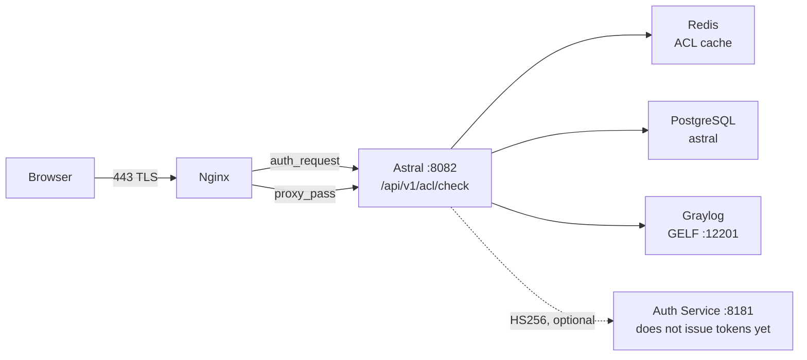

# 🔐 Integration Guide — Astral Auth Service

> Contract between **Astral Platform & HCI** and the **Astral Auth Service**
> (`:8181`), on the path that decides whether a domain opens or not.

## 📊 Status in one sentence

Astral's ACL engine **accepts** Bearer JWT from the Auth Service, but this is
**off by default** — the Auth Service is still stateless with HTTP Basic and
issues no token. The path that works today is the **portal session**. See
[section 28](#28-why-the-auth-service-should-not-be-documented-as-jwt).

| | |
|---|---|
| **Does it need the Auth Service to work?** | No. The portal session is enough |
| **Is the Auth Service called at runtime?** | No. `:8181` appears in no `.java` |
| **When is the JWT verified?** | Only with `ASTRAL_AUTH_JWT_ENABLED=true` **and** a secret of ≥32 bytes |
| **Risk if the Auth Service goes down?** | None for the ACL: validation is local, via HS256 |

---

## 1. Purpose of this document

For whoever is going to **operate** the integration between the two ends, and for
whoever is going to **implement token issuance** in the Auth Service. It
describes what Astral expects, what it already tolerates, and what does not
exist yet.

This is not an OAuth 2.0 tutorial. It is the concrete contract: which headers,
which claims, which statuses, which defaults.

## 2. What the Astral Auth Service is

An authentication service that runs on **`:8181`**, next to Astral. Today it is
*stateless* with HTTP Basic: it validates the credential and keeps no state.

It **issues no token**. There is no issuer, no `iss`, no JWKS. The only thing
Astral knows how to do with it today is **validate an HS256 that someone else
signed** — and that validation is off by default.

## 3. Topology: where the two ends meet



The dashed arrow is the honest point of the design: **nobody calls the Auth
Service during a request**. The arrow exists for the contract, not for traffic.

## 4. The path of a request

1. The browser requests `https://<host>/<uri>` on **443**.
2. Nginx answers in `location /` and **before** any `proxy_pass` fires
   `auth_request /acl-check`.
3. `location = /acl-check` is `internal`: only Nginx itself reaches it.
4. The subrequest goes to `http://astral_app/api/v1/acl/check` — the upstream
   `astral_app` is `127.0.0.1:8082`.
5. The engine returns **200**, **403** or **401**. Nginx accepts only those three.
6. **200** → Nginx proceeds to `proxy_pass http://astral_app`.
   **403** → `error_page 403 /bloqueado.html`, which the script writes to
   `/etc/nginx/astral/bloqueado.html`.

## 5. What Nginx forwards to the engine

The `location = /acl-check` block in `scripts/configure-nginx.sh` builds the
subrequest with `proxy_pass_request_body off` and `Content-Length ""`, and
forwards:

| Header | Value | Purpose |
|---|---|---|
| `Host` | `$host` | **Required** — see [section 6](#6-why-the-host-header-is-required) |
| `X-Original-Host` | `$host` | the host the user typed |
| `X-Original-URI` | `$request_uri` | the path the user requested |
| `X-Real-IP` | `$remote_addr` | — |
| `X-Forwarded-For` | `$proxy_add_x_forwarded_for` | the client's real IP |
| `Authorization` | forwarded by default | the `Bearer` carrier, when present |

`Authorization` has **no** dedicated `proxy_set_header`: Nginx forwards client
headers by default and the lines above only add. If someone rewrites that block
and starts listing headers one by one, `Authorization` disappears — and the JWT
stops working with no visible error. It is the kind of regression that
[section 16](#16-source-2--the-bearer-jwt) makes easy not to notice.

On the engine side, the reading is (`AclCheckController`):

- **host**: `X-Original-Host` → `X-Forwarded-Host` → `Host`
- **uri**: `X-Original-URI` → `requestURI`, without query string
- **ip**: `X-Forwarded-For`, **first** value of the list

## 6. Why the Host header is required

Without that line, Nginx uses the default `proxy_set_header Host $proxy_host`,
and `$proxy_host` of a **named** upstream is the upstream's own name:
`astral_app`.

Tomcat rejects a `Host` with an underscore and replies **400**. `auth_request`
only accepts 200/401/403, so the 400s become **500 on the user's page** —
including on public pages, with a stack trace that has nothing to do with ACL.
The symptom in the log is `auth request unexpected status: 400`.

Do not remove that line. If you rename the upstream, the problem comes back.

## 7. The status contract

The engine has **three** possible statuses, and no others:

| Status | `action` | What Nginx does |
|---|---|---|
| **200** | `ALLOW` | lets it through |
| **403** | `DENY` | `error_page 403 /bloqueado.html` |
| **401** | `UNAUTHENTICATED` or `ERROR` | asks for authentication |

## 8. Why never 500

A 500 from the engine becomes an error page in the middle of the proxy, and the
cause becomes invisible to whoever is trying to use the system. A **200 out of
doubt** is fail-open by another name — exactly what an access control must not
be.

That is why the infrastructure fallback is **401** and not 200: when the engine
cannot decide, it **says it cannot decide**. `AclDecision.erro()` returns 401
with `action=ERROR`, and the comment in the code is literal about it.

## 9. Accepted methods: GET and POST

The endpoint accepts both methods. The body is **not** read: what decides is the
host, the URI and the identity. Accepting `POST` is a convenience for tools that
do not control the method; Nginx's `auth_request` uses `GET`.

## 10. The response body

Nginx **discards** the subrequest body. It exists so the endpoint is testable
with `curl` alone — and a security endpoint you cannot test without a browser
becomes a finding in the next audit.

```json
{
  "status": 403,
  "action": "DENY",
  "host": "example.com",
  "uri": "/app/index.html",
  "categoria": "JOGOS",
  "grupo": "ALUNOS",
  "origem": "RECONCILIA",
  "motivo": "categoria bloqueada para o grupo",
  "usuario": "joao",
  "fonte": "SESSAO/AD",
  "ip": "192.168.2.50",
  "ms": 2
}
```

| Field | What it is |
|---|---|
| `status` | same as the HTTP status |
| `action` | `ALLOW`, `DENY`, `UNAUTHENTICATED` or `ERROR` |
| `categoria` | the domain's category |
| `grupo` | the groups that entered the decision |
| `origem` | where the decision came from (e.g. `RECONCILIA`) |
| `motivo` | the sentence a human understands |
| `usuario` | who requested |
| `fonte` | where the **identity** came from (e.g. `SESSAO/AD`, `JWT`) |
| `ms` | how long the engine took |

## 11. How to test without bringing up Nginx

The endpoint is `permitAll` in `SecurityConfig` — on purpose, because the real
gate is `auth_request`. That leaves it directly reachable by `curl`:

```bash
curl -i -H 'X-Original-Host: example.com' \
        -H 'X-Original-URI: /app/index.html' \
        http://127.0.0.1:8082/api/v1/acl/check
```

Notice there is **no** `Authorization`: without a Bearer and without a session,
the reply is **401**, and `motivo` says exactly which of the two was missing. A
403 here is a policy answer; a 401 is a credential answer.

## 12. Public paths: why they exist

The list is configurable in `astral.acl.public-paths`, comma-separated — precisely
so a new published path does not depend on a redeploy. The default is 14 entries:

```
/  /login  /home  /inicio  /app/  /assets/  /images/  /favicon.ico
/api/auth/login  /api/certs/ca/download  /error
/actuator/  /v3/api-docs/  /swagger-ui/
```

Two of them deserve attention from whoever reviews: `/` is on the list because it
is the initial redirect, and **`/actuator/` is public** — which includes
`/actuator/health`. A health check should not expose system detail to any
visitor of 443; if your environment cannot accept that, remove the entry instead
of filtering path by path.

Outside this list, everything answers **before** looking at identity, with
`origem=PUBLICA` and `motivo="caminho publico (sem ACL)"`.

Without this, Nginx would require identity **to reach login** — which is locking
the door from the inside.

## 13. Two lists that must agree

The `permitAll` in `SecurityConfig` and the `astral.acl.public-paths` in the
engine are the **same decision written twice**, in different places.

If they diverge, **it is not a security hole** — Spring Security remains the
real gate for the APIs. The symptom is a blocked login or a public screen that
asks for a session. It is the first thing to check when either stops matching.

## 14. The two identity sources

`AclIdentityResolver` tries, **in this order**:

1. **Bearer JWT** — the diagram's contract.
2. **Portal session** — whoever already logged in.

The first that resolves wins. If both fail, the engine returns 401 with origin
`IDENTIDADE`.

The choice is verified **locally**, via HS256, not by asking the Auth Service to
confirm on every request: that would trade a 2ms engine for a network call per
page, and an Auth Service that is down would start deciding navigation.

## 15. Source 1 — the portal session

This is the path that works **today**.

`SecurityContextHolder` provides the authentication. When the principal is an
`AstralPrincipal`, the user comes from AD and the groups from
`getAdGroups()`, with `fonte` = `SESSAO/<origin>` (e.g. `SESSAO/AD`).

When the principal is **not** an `AstralPrincipal` — source `POSTGRES/LINUX` —
the identity is valid but the group is not: the `authorities` become groups after
removing `ROLE_`, `USER` and `ADMIN`, in lowercase, with `fonte=SESSAO`. It is
this case that the wildcard rule `*` covers.

## 16. Source 2 — the Bearer JWT

Reads `Authorization: Bearer <token>`. The `sub` becomes the user, groups come
from the claims. An expired token, with a wrong signature or a divergent secret
is **not an engine error** — it is a credential that did not pass. It falls back
to the session, with a `debug` log.

The decoder only exists if `astral.auth.jwt.enabled=true` **and** the secret has
≥32 bytes. If either is missing, `decoder` is `null` and the Bearer path is not
even attempted.

## 17. Which claim becomes the user, which becomes the group

| Claim | Use |
|---|---|
| `sub` | **user** — required; without `sub` the token is discarded |
| `groups` | groups (first present claim wins) |
| `roles` | groups, if `groups` is absent |
| `memberOf` | groups, if the two above are absent |
| `realm_access.roles` | groups, Keycloak format |

Groups are normalized to **uppercase, sorted and deduplicated**, because the cache
key must be canonical: the same set in different orders must hit the same entry.

## 18. HS256 and the shared secret

The decoder is `NimbusJwtDecoder.withSecretKey(...).macAlgorithm(HS256)`, with the
secret coming from `astral.auth.jwt.secret`.

It is **HS256**, not RS256: the signature is symmetric, so **both sides need the
same secret**. There is no public key to distribute and no JWKS to query. This is
the contract with an Auth Service that lives on the same machine and the same
network.

For the Auth Service to gain issuance, it must sign with **the same secret**.
Diverging produces no visible error: the token is simply rejected and falls back
to the session.

## 19. The 32-byte requirement

`HS256` with fewer than 256 bits is brute-forceable. If the secret has fewer than
32 bytes, the code **validates nothing** and logs:

```
acl: astral.auth.jwt.secret com menos de 32 bytes;
verificacao de Bearer DESLIGADA ate corrigir
```

We prefer validating nothing over validating badly. With
`ASTRAL_AUTH_JWT_ENABLED=true` and a short secret, the ACL **keeps working**
through the session — only the Bearer is ignored.

## 20. `ASTRAL_AUTH_JWT_ENABLED`

The switch. Default **`false`**.

| Variable | Default | What it does |
|---|---|---|
| `ASTRAL_AUTH_JWT_ENABLED` | `false` | Turns on Bearer decoding |
| `ASTRAL_AUTH_JWT_SECRET` | empty | Shared HS256 secret |

To turn it on: `ASTRAL_AUTH_JWT_ENABLED=true` and a secret of ≥32 bytes, **equal
on both sides**. Without turning it on, the JWT path exists in the code but never
executes.

## 21. What the validation does NOT check

This matters for whoever implements issuance:

- **It does not validate `iss`.** There is no expected issuer.
- **It does not validate `aud`.** There is no expected audience.
- **It does not validate `nbf` beyond the clock.** The validator is a
  `JwtTimestampValidator` with a **60-second tolerance** — Spring's default is
  60s of clock, and what changes here is that it was **replaced** by a
  time-only validator.

In other words: a valid HS256 token, with `sub`, inside the time window, is
accepted. Put into the token everything that needs to be verified.

## 22. Group decides passage; role decides editing

`AclIdentity` is **not** a Spring authority and not a security principal. It is
the minimal slice that the policy crosses with the domain's category.

- **Role** decides who **edits** the policy. The whole CRUD
  (`/api/v1/acl/{categories,domains,overrides,rules}`) sits behind
  `@PreAuthorize("hasRole('ASTRAL_ADMIN')")` on the class `AclAdminController` —
  it is the only place in the engine where the role appears.
- **Group** decides who **passes**, and that is `AclRule.adGroup`.

Mixing the two is how an administrator permission becomes a navigation release.
The `source` stays in the record on purpose: the audit asks "where did this
identity come from", and an answer without that question is useless for later
investigation.

## 23. The engine's four steps

Always in this order — the order **is** the policy:

| Step | What | Where |
|---|---|---|
| **A** | explicit domain exception | in-memory index |
| — | decision cache (15 min) | Redis |
| **B** | domain category | Redis → PostgreSQL |
| **C** | category × group rule | Redis → PostgreSQL |

**STEP A** comes before everything because an exception is when the operator
said "from this specific host, nothing": running it after the crossing would
force the operator to also write the exception in the category.

The exception has four actions, and one of them is not a decision: **`BYPASS`
skips the whole engine, including the cache**, returning `ALLOW` with origin
`PASSO_A/bypass`. It is the "maintenance exception" — for the case where not
even the common crossing serves.

## 24. The two defaults

| Situation | Default | Configurable |
|---|---|---|
| Category exists, no rule covers the group | **`DENY`** | `astral.acl.default-without-rule` |
| The domain has no category | **`ALLOW`** | `astral.acl.default-uncategorized` |

The house default is `DENY`. The `ALLOW` for uncategorized exists because there
are environments that want "only what is marked as blocked by default is denied"
— it is a conscious choice, not a default.

These defaults close the engine: **no identity 401, no category the policy
decides, no rule the policy decides**.

## 25. Redis: TTLs and the fallback

| Key | TTL | Why |
|---|---|---|
| domain → category | 1h | rarely changes |
| category + group → action | 5m | changes when the rule changes |
| identity + domain → decision | 15m | hot path |
| exception index | 60s | a new exception must take effect fast |

The Redis timeout is **500 ms** on purpose: if it goes down, the fallback to
PostgreSQL must happen in milliseconds, not after 5s per request.

The **exception index has a TTL too** because rebuilding it on every request
would turn the 2ms into a database query.

## 26. Audit and retention

Every decision becomes a **GELF event over UDP**, hand-written, with no new
dependency, to Graylog on `:12201`. The queue has a ceiling of 8192. If Graylog
disappears, a **JSONL fallback** keeps the trail in
`/var/log/astral/graylog-fallback.jsonl`.

The series live in **TimescaleDB hypertables**, with **30-day retention** — the
horizon in which a Friday peak is still comparable to the following Friday's.
That is ~5,760 rows/day per series × 4 series × 30 days ≈ 700 thousand rows.

`drop_chunks` is what keeps the series from becoming a disk incident. And the
conversion to hypertable lives in a **script**, not a migration, because
`create_hypertable` requires superuser and Flyway runs as `astral`, which is not.

## 27. What happens if the Auth Service goes down

**Nothing changes in the ACL.** Because nothing on the hot path calls it.

The engine validates the Bearer **locally**, via HS256. An Auth Service that is
down does not enter any equation — not for deny, not for allow.

What breaks, if the Auth Service ever starts issuing, is **issuance** of the
token: the user without a session and without a token will receive 401 with
`action=UNAUTHENTICATED`, and `motivo` will say that a valid Bearer **and** a
session were missing.

## 28. Why the Auth Service should not be documented as JWT

This section exists because the temptation is great and the mistake is costly.

**The Auth Service on `:8181` issues no token today.** Documenting it as a JWT
issuer would do three wrong things at once:

1. **It would make the ACL look optional.** If JWT were the normal path,
   turning `ASTRAL_AUTH_JWT_ENABLED` off would look like a configuration error.
   It is not: it is the default, and the ACL has worked that way since the
   portal session exists.
2. **It would make the 401 look like a bug.** A `401 UNAUTHENTICATED` with
   `motivo="sem Bearer valido e sem sessao do portal"` is **both sources
   failing**, which is the designed behavior — not a broken JWT.
3. **It would make the 15-minute cache TTL look safe on its own.** The decision
   is cached with the identity that produced it; if that identity came from an
   annulled session, the cache holds the old result. A short TTL amortizes, it
   does not solve.

Until the Auth Service gains real issuance, the honest thing is what is in
`application.yml`:

```
astral.auth.jwt.enabled=${ASTRAL_AUTH_JWT_ENABLED:false}
```

Off by default. Validating a JWT that nobody issues is work for nothing.

**When issuance exists**, three things must change together, and only in this
order:

1. The Auth Service starts signing with `HS256` and the **same** secret of
   `ASTRAL_AUTH_JWT_SECRET`.
2. `ASTRAL_AUTH_JWT_ENABLED=true` in the environment, with ≥32 bytes.
3. Only then does the JWT become documentable as a production path — and
   [section 19](#19-the-32-byte-requirement) becomes the first number to check
   when nobody can get through.

---

## ✅ Integration checklist

- [ ] `ASTRAL_AUTH_JWT_ENABLED=false` and `ASTRAL_AUTH_JWT_SECRET` empty — the default, and it is working
- [ ] `curl` on `/api/v1/acl/check` returns **401** without Bearer and without a session (not 500)
- [ ] The same `curl` with a valid session returns **200** or **403** according to policy
- [ ] `astral.acl.public-paths` and the `permitAll` of `SecurityConfig` match
- [ ] Nginx has `proxy_set_header Host $host` in `location = /acl-check`
- [ ] The `error log` has no `auth request unexpected status: 400`
- [ ] The Graylog JSONL fallback exists and is growing
- [ ] If JWT was turned on: the secret has ≥32 bytes and is **equal** to the Auth Service's
- [ ] If JWT was turned on: the token carries `sub` and groups in `groups`, `roles` or `memberOf`

## 📎 Reference index

| What | Where |
|---|---|
| Endpoint | `src/main/java/com/astral/fabric/proxy/AclCheckController.java` |
| Engine | `src/main/java/com/astral/fabric/proxy/AclEvaluatorService.java` |
| Identity sources | `src/main/java/com/astral/fabric/proxy/AclIdentityResolver.java` |
| Status contract | `src/main/java/com/astral/fabric/proxy/AclDecision.java` |
| Identity slice | `src/main/java/com/astral/fabric/proxy/AclIdentity.java` |
| Cache | `src/main/java/com/astral/fabric/proxy/AclCacheService.java` |
| Audit | `src/main/java/com/astral/fabric/proxy/audit/GraylogAuditPublisher.java` |
| ACL key (the check's `permitAll`) | `src/main/java/com/astral/main/security/SecurityConfig.java` |
| Nginx block | `scripts/configure-nginx.sh` |
| Retention | `scripts/configure-timescaledb.sh` |
| Configuration | `src/main/resources/application.yml` |

---

*This document describes the code as it is. If token issuance changes in the
Auth Service, update [section 28](#28-why-the-auth-service-should-not-be-documented-as-jwt)
and the checklist — do not let section 28 go stale.*