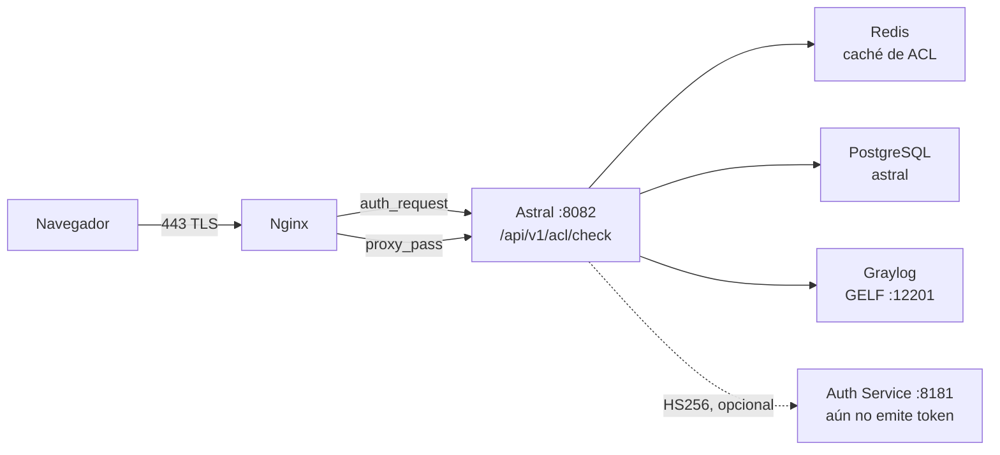

# 🔐 Guía de Integración — BrasilCloud Auth Service

> Contrato entre **Astral Platform & HCI** y el **BrasilCloud Auth Service**
> (`:8181`), en el camino que decide si un dominio se abre o no.

## 📊 Estado en una frase

El motor de ACL de Astral **acepta** Bearer JWT del Auth Service, pero eso está
**desactivado por defecto** — el Auth Service sigue siendo stateless con HTTP
Basic y no emite token. El camino que funciona hoy es la **sesión del portal**.
Ver la [sección 28](#28-por-que-el-auth-service-no-debe-documentarse-como-jwt).

| | |
|---|---|
| **¿Necesita el Auth Service para funcionar?** | No. La sesión del portal basta |
| **¿Se llama al Auth Service en runtime?** | No. `:8181` no aparece en ningún `.java` |
| **¿Cuándo se verifica el JWT?** | Solo con `ASTRAL_AUTH_JWT_ENABLED=true` **y** secreto con ≥32 bytes |
| **¿Riesgo si el Auth Service cae?** | Ninguno para el ACL: la validación es local, por HS256 |

---

## 1. Para qué sirve este documento

Para quien va a **operar** la integración entre las dos puntas, y para quien va a
**implementar la emisión de token** en el Auth Service. Describe lo que Astral
espera, lo que ya tolera y lo que aún no existe.

No es un tutorial de OAuth 2.0. Es el contrato concreto: qué headers, qué
claims, qué status, qué defaults.

## 2. Qué es el BrasilCloud Auth Service

Un servicio de autenticación que corre en **`:8181`**, al lado de Astral. Hoy
es *stateless* con HTTP Basic: valida la credencial y no guarda estado.

**No emite token.** No hay emisor, no hay `iss`, no hay JWKS. Lo único que
Astral sabe hacer con él, hoy, es **validar un HS256 que otro haya firmado** —
y esa validación está desactivada por defecto.

## 3. Topología: dónde se encuentran las dos puntas



La flecha punteada es el punto honesto del diseño: **nadie llama al Auth
Service durante una petición**. La flecha existe para el contrato, no para el
tráfico.

## 4. El camino de una petición

1. El navegador pide `https://<host>/<uri>` en el **443**.
2. Nginx atiende en `location /` y **antes** de cualquier `proxy_pass` dispara
   `auth_request /acl-check`.
3. `location = /acl-check` es `internal`: solo el propio Nginx llega a él.
4. El subrequest va a `http://astral_app/api/v1/acl/check` — el upstream
   `astral_app` es `127.0.0.1:8082`.
5. El motor devuelve **200**, **403** o **401**. Nginx acepta solo esos tres.
6. **200** → Nginx sigue a `proxy_pass http://astral_app`.
   **403** → `error_page 403 /bloqueado.html`, que el script escribe en
   `/etc/nginx/astral/bloqueado.html`.

## 5. Lo que Nginx repasa al motor

El bloque `location = /acl-check` en `scripts/configure-nginx.sh` arma el
subrequest con `proxy_pass_request_body off` y `Content-Length ""`, y repasa:

| Header | Valor | Para qué sirve |
|---|---|---|
| `Host` | `$host` | **Obligatorio** — ver [sección 6](#6-por-que-el-cabecera-host-es-obligatoria) |
| `X-Original-Host` | `$host` | el host que el usuario digitó |
| `X-Original-URI` | `$request_uri` | la ruta que el usuario pidió |
| `X-Real-IP` | `$remote_addr` | — |
| `X-Forwarded-For` | `$proxy_add_x_forwarded_for` | la IP real del cliente |
| `Authorization` | repasado por defecto | el portador del `Bearer`, cuando exista |

`Authorization` **no** tiene `proxy_set_header` propio: Nginx repasa los headers
del cliente por defecto y las líneas anteriores solo añaden. Si alguien reescribe
ese bloque y pasa a listar headers uno a uno, el `Authorization` desaparece — y
el JWT deja de funcionar sin error visible. Es el tipo de regresión que la
[sección 16](#16-fuente-2--el-bearer-jwt) hace fácil de no notar.

Del lado del motor, la lectura es (`AclCheckController`):

- **host**: `X-Original-Host` → `X-Forwarded-Host` → `Host`
- **uri**: `X-Original-URI` → `requestURI`, sin query string
- **ip**: `X-Forwarded-For`, **primer** valor de la lista

## 6. Por qué el cabecera Host es obligatoria

Sin esa línea, Nginx usa el default `proxy_set_header Host $proxy_host`, y
`$proxy_host` de un upstream **nombrado** es el propio nombre del upstream:
`astral_app`.

Tomcat rechaza un `Host` con guion bajo y responde **400**. `auth_request` solo
acepta 200/401/403, así que los 400 se vuelven **500 en la página del usuario**
— incluso en las páginas públicas, con un stack trace que no tiene nada que ver
con ACL. El síntoma en el log es `auth request unexpected status: 400`.

No quites esa línea. Si cambias el nombre del upstream, el problema vuelve.

## 7. El contrato de status

El motor tiene **tres** status posibles, y ningún otro:

| Status | `action` | Lo que hace Nginx |
|---|---|---|
| **200** | `ALLOW` | deja pasar |
| **403** | `DENY` | `error_page 403 /bloqueado.html` |
| **401** | `UNAUTHENTICATED` o `ERROR` | pide autenticación |

## 8. Por qué nunca 500

Un 500 del motor se vuelve página de error en medio del proxy, y la causa queda
invisible para quien intenta usar el sistema. Un **200 por duda** es fail-open con
otro nombre — exactamente lo que un control de acceso no puede ser.

Por eso el fallback de infraestructura es **401** y no 200: cuando el motor no
sabe decidir, **dice que no sabe**. `AclDecision.erro()` devuelve 401 con
`action=ERROR`, y el comentario en el código es literal sobre esto.

## 9. Métodos aceptados: GET y POST

El endpoint acepta ambos métodos. El cuerpo **no** se lee: quien decide es el
host, la URI y la identidad. Aceptar `POST` es conveniencia para herramientas
que no controlan el método; el `auth_request` de Nginx usa `GET`.

## 10. El cuerpo de la respuesta

Nginx **descarta** el cuerpo del subrequest. Existe para que el endpoint sea
probable solo con `curl` — y un endpoint de seguridad que no se puede probar sin
navegador se vuelve un hallazgo en el próximo audit.

```json
{
  "status": 403,
  "action": "DENY",
  "host": "example.com",
  "uri": "/app/index.html",
  "categoria": "JOGOS",
  "grupo": "ALUNOS",
  "origem": "RECONCILIA",
  "motivo": "categoria bloqueada para o grupo",
  "usuario": "joao",
  "fonte": "SESSAO/AD",
  "ip": "192.168.2.50",
  "ms": 2
}
```

| Campo | Qué es |
|---|---|
| `status` | el mismo que el status HTTP |
| `action` | `ALLOW`, `DENY`, `UNAUTHENTICATED` o `ERROR` |
| `categoria` | la categoría del dominio |
| `grupo` | los grupos que entraron en la decisión |
| `origem` | de dónde vino la decisión (p. ej. `RECONCILIA`) |
| `motivo` | la frase que un humano entiende |
| `usuario` | quien pidió |
| `fonte` | de dónde vino la **identidad** (p. ej. `SESSAO/AD`, `JWT`) |
| `ms` | cuánto tardó el motor |

## 11. Cómo probar sin levantar Nginx

El endpoint es `permitAll` en `SecurityConfig` — a propósito, porque quien hace
el portón de verdad es `auth_request`. Eso lo deja directo al `curl`:

```bash
curl -i -H 'X-Original-Host: example.com' \
        -H 'X-Original-URI: /app/index.html' \
        http://127.0.0.1:8082/api/v1/acl/check
```

Repara en que **no** hay `Authorization`: sin Bearer y sin sesión, la respuesta
es **401**, y `motivo` dice exactamente cuál de las dos faltó. Un 403 aquí es
respuesta de política; un 401 es respuesta de credencial.

## 12. Rutas públicas: por qué existen

La lista es configurable en `astral.acl.public-paths`, separada por coma —
justamente para no depender de redeploy cuando se publica una ruta nueva. El
default son 14 entradas:

```
/  /login  /home  /inicio  /app/  /assets/  /images/  /favicon.ico
/api/auth/login  /api/certs/ca/download  /error
/actuator/  /v3/api-docs/  /swagger-ui/
```

Dos de ellas merecen atención de quien revisa: `/` está en la lista porque es el
redirect inicial, y **`/actuator/` es pública** — lo que incluye
`/actuator/health`. Un health check no debería exponer detalle de sistema a
cualquier visitante del 443; si tu entorno no puede asumirlo, quita la entrada
en vez de filtrar ruta por ruta.

Fuera de esta lista, todo responde **antes** de mirar identidad, con
`origem=PUBLICA` y `motivo="caminho publico (sem ACL)"`.

Sin esto, Nginx exigiría identidad **para llegar al login** — que es cerrar la
puerta por dentro.

## 13. Dos listas que deben concordar

El `permitAll` del `SecurityConfig` y el `astral.acl.public-paths` del motor son
la **misma decisión escrita dos veces**, en lugares distintos.

Si divergen, **no es un hueco de seguridad** — Spring Security sigue siendo el
portón de verdad de las APIs. El síntoma es un login bloqueado o una pantalla
pública que pide sesión. Es lo primero que hay que verificar cuando cualquiera de
los dos deja de casar.

## 14. Las dos fuentes de identidad

`AclIdentityResolver` intenta, **en este orden**:

1. **Bearer JWT** — el contrato del diagrama.
2. **Sesión del portal** — quien ya inició sesión.

La primera que resuelve gana. Si ambas fallan, el motor devuelve 401 con origen
`IDENTIDADE`.

La elección se verifica **localmente**, por HS256, no pidiendo confirmación al
Auth Service en cada petición: eso cambiaría un motor de 2ms por una llamada de
red por página, y un Auth Service caído pasaría a decidir navegación.

## 15. Fuente 1 — la sesión del portal

Es el camino que funciona **hoy**.

`SecurityContextHolder` proporciona la autenticación. Cuando el principal es un
`AstralPrincipal`, el usuario viene del AD y los grupos de `getAdGroups()`, con
`fonte` = `SESSAO/<origen>` (p. ej. `SESSAO/AD`).

Cuando el principal **no** es un `AstralPrincipal` — fuente `POSTGRES/LINUX` —,
la identidad vale pero el grupo no: las `authorities` se vuelven grupos después
de quitar `ROLE_`, `USER` y `ADMIN`, en minúsculas, con `fonte=SESSAO`. Es ese
caso el que cubre la regla con comodín `*`.

## 16. Fuente 2 — el Bearer JWT

Se lee `Authorization: Bearer <token>`. El `sub` se vuelve usuario, los grupos
vienen de los claims. Un token expirado, con firma errónea o de secreto
divergente **no es error del motor** — es una credencial que no pasó. Cae a la
sesión, con log en `debug`.

El decodificador solo existe si `astral.auth.jwt.enabled=true` **y** el secreto
tiene ≥32 bytes. Si falta uno de los dos, `decoder` queda `null` y el camino
del Bearer ni se intenta.

## 17. Qué claim se vuelve usuario, cuál grupo

| Claim | Uso |
|---|---|
| `sub` | **usuario** — obligatorio; sin `sub` el token se descarta |
| `groups` | grupos (la primera claim presente gana) |
| `roles` | grupos, si `groups` no existe |
| `memberOf` | grupos, si las dos anteriores no existen |
| `realm_access.roles` | grupos, formato Keycloak |

Los grupos se normalizan a **mayúsculas, ordenados y deduplicados**, porque la
clave de caché debe ser canónica: el mismo conjunto en órdenes distintas tiene
que caer en la misma entrada.

## 18. HS256 y el secreto compartido

El decodificador es `NimbusJwtDecoder.withSecretKey(...).macAlgorithm(HS256)`,
con el secreto viniendo de `astral.auth.jwt.secret`.

Es **HS256**, no RS256: la firma es simétrica, así que **ambos lados necesitan
el mismo secreto**. No hay clave pública que distribuir ni JWKS que consultar.
Este es el contrato con un Auth Service que vive en la misma máquina y la misma
red.

Para que el Auth Service gane emisión, debe firmar con **el mismo secreto**.
Divergir no da error visible: el token simplemente se rechaza y cae a la sesión.

## 19. La exigencia de los 32 bytes

`HS256` con menos de 256 bits es fuerza bruta en horizontal. Si el secreto
tiene menos de 32 bytes, el código **no valida nada** y registra:

```
acl: astral.auth.jwt.secret com menos de 32 bytes;
verificacao de Bearer DESLIGADA ate corrigir
```

Preferimos no validar nada a validar mal. Con `ASTRAL_AUTH_JWT_ENABLED=true` y
secreto corto, el ACL **sigue funcionando** por la sesión — solo el Bearer se
ignora.

## 20. `ASTRAL_AUTH_JWT_ENABLED`

El interruptor. Por defecto **`false`**.

| Variable | Por defecto | Qué hace |
|---|---|---|
| `ASTRAL_AUTH_JWT_ENABLED` | `false` | Enciende la decodificación del Bearer |
| `ASTRAL_AUTH_JWT_SECRET` | vacío | Secreto HS256 compartido |

Para encender: `ASTRAL_AUTH_JWT_ENABLED=true` y un secreto de ≥32 bytes, **igual
en ambos lados**. Sin encender, el camino del JWT existe en el código pero
nunca ejecuta.

## 21. Lo que la validación NO verifica

Esto importa para quien implementa la emisión:

- **No valida `iss`.** No hay emisor esperado.
- **No valida `aud`.** No hay audiencia esperada.
- **No valida `nbf` más allá del reloj.** El validador es un
  `JwtTimestampValidator` con **tolerancia de 60 segundos** — el default de Spring
  es 60s de reloj, y lo que cambia aquí es que fue **sustituido** por un
  validador solo de tiempo.

Es decir: un token HS256 válido, con `sub`, dentro de la ventana de tiempo, se
acepta. Pon en el token todo lo que necesite verificarse.

## 22. Grupo decide el paso; rol decide la edición

`AclIdentity` **no** es una autoridad de Spring ni un principal de seguridad. Es
el recorte mínimo que la política cruza con la categoría del dominio.

- **Rol** decide quién **edita** la política. Todo el CRUD
  (`/api/v1/acl/{categories,domains,overrides,rules}`) está detrás de
  `@PreAuthorize("hasRole('ASTRAL_ADMIN')")` en la clase `AclAdminController` —
  es el único lugar del motor donde aparece el rol.
- **Grupo** decide quién **pasa**, y eso es `AclRule.adGroup`.

Mezclar los dos es como una permisión de administrador se convierte en liberación
de navegación. El `source` queda en el registro a propósito: la auditoría
pregunta "de dónde vino esta identidad", y una respuesta sin esa pregunta no
sirve para la investigación posterior.

## 23. Los cuatro pasos del motor

Siempre en este orden — el orden **es** la política:

| Paso | Qué | Dónde |
|---|---|---|
| **A** | excepción explícita de dominio | índice en memoria |
| — | caché de decisión (15 min) | Redis |
| **B** | categoría del dominio | Redis → PostgreSQL |
| **C** | regla categoría × grupo | Redis → PostgreSQL |

El **PASO A** viene antes de todo porque excepción es cuando el operador dijo
"de este host específico, nada": correrlo después del cruce obligaría al
operador a escribir la excepción también en la categoría.

La excepción tiene cuatro acciones, y una de ellas no es una decisión: **`BYPASS`
salta todo el motor, incluso el caché**, devolviendo `ALLOW` con origen
`PASSO_A/bypass`. Es la "excepción de mantenimiento" — para el caso en que ni
el cruce común sirve.

## 24. Los dos defaults

| Situación | Default | Configurable |
|---|---|---|
| La categoría existe, ninguna regla cubre el grupo | **`DENY`** | `astral.acl.default-without-rule` |
| El dominio ni categoría tiene | **`ALLOW`** | `astral.acl.default-uncategorized` |

El default de la casa es `DENY`. El `ALLOW` para no categorizado existe porque
hay ambientes que quieren "solo lo que está marcado como bloqueado por defecto
se niega" — es una elección consciente, no un default.

Estos defaults cierran el motor: **sin identidad 401, sin categoría la política
decide, sin regla la política decide**.

## 25. Redis: TTLs y el fallback

| Clave | TTL | Por qué |
|---|---|---|
| dominio → categoría | 1h | cambia raramente |
| categoría + grupo → acción | 5m | cambia cuando la regla cambia |
| identidad + dominio → decisión | 15m | camino caliente |
| índice de excepciones | 60s | una excepción nueva debe valer rápido |

El timeout de Redis es **500 ms** a propósito: si cae, el fallback a PostgreSQL
tiene que ocurrir en milisegundos, y no después de 5s por petición.

El **índice de excepciones tiene TTL también** porque reconstruirlo en cada
petición convertiría los 2ms en consulta a la base.

## 26. Auditoría y retención

Cada decisión se vuelve evento **GELF sobre UDP**, escrito a mano, sin
dependencia nueva, al Graylog en `:12201`. La cola tiene techo de 8192. Si el
Graylog desaparece, un **JSONL de fallback** guarda la traza en
`/var/log/astral/graylog-fallback.jsonl`.

Las series viven en **hypertables de TimescaleDB**, con **retención de 30 días**
— el horizonte en que un pico de viernes sigue siendo comparable al del viernes
siguiente. Son ~5.760 filas/día por serie × 4 series × 30 días ≈ 700 mil filas.

El `drop_chunks` es lo que impide que la serie se vuelva incidente de disco. Y
la conversión a hypertable queda en **script**, no en migración, porque
`create_hypertable` exige superuser y Flyway corre como `astral`, que no lo es.

## 27. Qué pasa si el Auth Service cae

**Nada cambia en el ACL.** Porque nada en el camino caliente lo llama.

El motor valida el Bearer **localmente**, por HS256. Un Auth Service caído no
entra en ninguna ecuación — ni para deny, ni para allow.

Lo que se rompe, si alguna vez el Auth Service empieza a emitir, es la
**emisión** del token: el usuario sin sesión y sin token recibirá 401 con
`action=UNAUTHENTICATED`, y `motivo` dirá que faltó Bearer válido **y** sesión.

## 28. Por qué el Auth Service no debe documentarse como JWT

Esta sección existe porque la tentación es grande y el error es caro.

**El Auth Service de `:8181` no emite token hoy.** Documentarlo como emisor JWT
haría tres cosas mal de una vez:

1. **Haría que el ACL parezca opcional.** Si el JWT fuera el camino normal,
   apagar `ASTRAL_AUTH_JWT_ENABLED` parecería un error de configuración. No lo
   es: es el default, y el ACL funciona así desde que existe la sesión del
   portal.
2. **Haría que el 401 parezca un bug.** Un `401 UNAUTHENTICATED` con
   `motivo="sem Bearer valido e sem sessao do portal"` es **ambas fuentes
   fallando**, que es el comportamiento diseñado — no un JWT roto.
3. **Haría que el TTL de caché de 15 minutos parezca seguro por sí solo.** La
   decisión se cachea con la identidad que la produjo; si esa identidad vino de
   una sesión anulada, el caché retiene el resultado anterior. Un TTL corto
   amortigua, no resuelve.

Hasta que el Auth Service gane emisión de verdad, lo honesto es lo que está en
`application.yml`:

```
astral.auth.jwt.enabled=${ASTRAL_AUTH_JWT_ENABLED:false}
```

Desactivado por defecto. Validar un JWT que nadie emite es trabajo por nada.

**Cuando exista la emisión**, tres cosas deben cambiar juntas, y solo en este
orden:

1. El Auth Service empieza a firmar con `HS256` y el **mismo** secreto de
   `ASTRAL_AUTH_JWT_SECRET`.
2. `ASTRAL_AUTH_JWT_ENABLED=true` en el entorno, con ≥32 bytes.
3. Solo entonces el JWT se vuelve documentable como camino de producción — y la
   [sección 19](#19-la-exigencia-de-los-32-bytes) pasa a ser el primer número a
   verificar cuando nadie consigue pasar.

---

## ✅ Checklist de integración

- [ ] `ASTRAL_AUTH_JWT_ENABLED=false` y `ASTRAL_AUTH_JWT_SECRET` vacío — el default, y está funcionando
- [ ] `curl` en `/api/v1/acl/check` devuelve **401** sin Bearer y sin sesión (no 500)
- [ ] El mismo `curl` con sesión válida devuelve **200** o **403** según la política
- [ ] `astral.acl.public-paths` y el `permitAll` del `SecurityConfig` casan
- [ ] Nginx tiene `proxy_set_header Host $host` en `location = /acl-check`
- [ ] El `error log` no tiene `auth request unexpected status: 400`
- [ ] El JSONL de fallback de Graylog existe y está creciendo
- [ ] Si el JWT se encendió: el secreto tiene ≥32 bytes y es **igual** al del Auth Service
- [ ] Si el JWT se encendió: el token trae `sub` y los grupos en `groups`, `roles` o `memberOf`

## 📎 Índice de referencias

| Qué | Dónde |
|---|---|
| Endpoint | `src/main/java/com/astral/fabric/proxy/AclCheckController.java` |
| Motor | `src/main/java/com/astral/fabric/proxy/AclEvaluatorService.java` |
| Fuentes de identidad | `src/main/java/com/astral/fabric/proxy/AclIdentityResolver.java` |
| Contrato de status | `src/main/java/com/astral/fabric/proxy/AclDecision.java` |
| Recorte de identidad | `src/main/java/com/astral/fabric/proxy/AclIdentity.java` |
| Caché | `src/main/java/com/astral/fabric/proxy/AclCacheService.java` |
| Auditoría | `src/main/java/com/astral/fabric/proxy/audit/GraylogAuditPublisher.java` |
| Clave ACL (el `permitAll` del check) | `src/main/java/com/astral/main/security/SecurityConfig.java` |
| Bloque Nginx | `scripts/configure-nginx.sh` |
| Retención | `scripts/configure-timescaledb.sh` |
| Configuración | `src/main/resources/application.yml` |

---

*Este documento describe el código como está. Si la emisión de token cambia en el
Auth Service, actualiza la [sección 28](#28-por-que-el-auth-service-no-debe-documentarse-como-jwt)
y el checklist — no dejes envejecer la sección 28.*