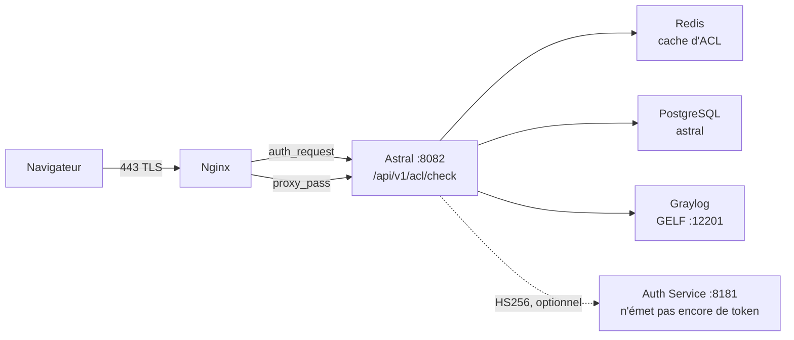

# 🔐 Guide d'Intégration — Astral Auth Service

> Contrat entre **Astral Platform & HCI** et le **Astral Auth Service**
> (`:8181`), sur le chemin qui décide si un domaine s'ouvre ou non.

## 📊 État en une phrase

Le moteur d'ACL d'Astral **accepte** le Bearer JWT de l'Auth Service, mais cela
est **désactivé par défaut** — l'Auth Service reste stateless avec HTTP Basic et
n'émet aucun token. Le chemin qui fonctionne aujourd'hui est la **session du
portail**. Voir la [section 28](#28-pourquoi-lauth-service-ne-doit-pas-être-documenté-comme-jwt).

| | |
|---|---|
| **A-t-il besoin de l'Auth Service pour fonctionner ?** | Non. La session du portail suffit |
| **L'Auth Service est-il appelé en runtime ?** | Non. `:8181` n'apparaît dans aucun `.java` |
| **Quand le JWT est-il vérifié ?** | Seulement avec `ASTRAL_AUTH_JWT_ENABLED=true` **et** un secret de ≥32 octets |
| **Risque si l'Auth Service tombe ?** | Aucun pour l'ACL : la validation est locale, par HS256 |

---

## 1. À quoi sert ce document

Pour qui va **opérer** l'intégration entre les deux bouts, et pour qui va
**implémenter l'émission de token** dans l'Auth Service. Il décrit ce qu'Astral
attend, ce qu'il tolère déjà, et ce qui n'existe pas encore.

Ce n'est pas un tutoriel OAuth 2.0. C'est le contrat concret : quels headers,
quels claims, quels status, quels defaults.

## 2. Qu'est-ce que le Astral Auth Service

Un service d'authentification qui tourne sur **`:8181`**, à côté d'Astral.
Aujourd'hui il est *stateless* avec HTTP Basic : il valide la credential et ne
garde aucun état.

Il **n'émet aucun token**. Pas d'émetteur, pas de `iss`, pas de JWKS. La seule
chose qu'Astral sait faire avec lui, aujourd'hui, est **valider un HS256 qu'un
autre aurait signé** — et cette validation est désactivée par défaut.

## 3. Topologie : où les deux bouts se rencontrent



La flèche en pointillés est le point honnête du dessin : **personne n'appelle
l'Auth Service pendant une requête**. La flèche existe pour le contrat, pas pour
le trafic.

## 4. Le chemin d'une requête

1. Le navigateur demande `https://<host>/<uri>` sur le **443**.
2. Nginx répond dans `location /` et **avant** tout `proxy_pass` déclenche
   `auth_request /acl-check`.
3. `location = /acl-check` est `internal` : seul Nginx lui-même y accède.
4. Le subrequest va vers `http://astral_app/api/v1/acl/check` — l'upstream
   `astral_app` est `127.0.0.1:8082`.
5. Le moteur renvoie **200**, **403** ou **401**. Nginx n'accepte que ces trois.
6. **200** → Nginx poursuit vers `proxy_pass http://astral_app`.
   **403** → `error_page 403 /bloqueado.html`, que le script écrit dans
   `/etc/nginx/astral/bloqueado.html`.

## 5. Ce que Nginx repasse au moteur

Le bloc `location = /acl-check` dans `scripts/configure-nginx.sh` monte le
subrequest avec `proxy_pass_request_body off` et `Content-Length ""`, et repasse :

| Header | Valeur | À quoi ça sert |
|---|---|---|
| `Host` | `$host` | **Obligatoire** — voir [section 6](#6-pourquoi-le-header-host-est-obligatoire) |
| `X-Original-Host` | `$host` | l'hôte que l'utilisateur a tapé |
| `X-Original-URI` | `$request_uri` | le chemin que l'utilisateur a demandé |
| `X-Real-IP` | `$remote_addr` | — |
| `X-Forwarded-For` | `$proxy_add_x_forwarded_for` | la vraie IP du client |
| `Authorization` | repassé par défaut | le porteur du `Bearer`, s'il y en a |

`Authorization` **n'a pas** de `proxy_set_header` dédié : Nginx repasse les
headers du client par défaut et les lignes ci-dessus n'ajoutent que. Si
quelqu'un réécrit ce bloc et se met à lister les headers un par un,
`Authorization` disparaît — et le JWT cesse de fonctionner sans erreur visible.
C'est le genre de régression que la [section 16](#16-source-2--le-bearer-jwt)
rend facile à ne pas remarquer.

Du côté du moteur, la lecture est (`AclCheckController`) :

- **host** : `X-Original-Host` → `X-Forwarded-Host` → `Host`
- **uri** : `X-Original-URI` → `requestURI`, sans query string
- **ip** : `X-Forwarded-For`, **première** valeur de la liste

## 6. Pourquoi le header Host est obligatoire

Sans cette ligne, Nginx utilise le default `proxy_set_header Host $proxy_host`,
et `$proxy_host` d'un upstream **nommé** est le nom même de l'upstream :
`astral_app`.

Tomcat refuse un `Host` avec un underscore et répond **400**. `auth_request`
n'accepte que 200/401/403, donc les 400 deviennent **500 sur la page de
l'utilisateur** — y compris sur les pages publiques, avec une stack trace qui
n'a rien à voir avec l'ACL. Le symptôme dans le log est
`auth request unexpected status: 400`.

Ne supprimez pas cette ligne. Si vous renommez l'upstream, le problème revient.

## 7. Le contrat de status

Le moteur a **trois** status possibles, et aucun autre :

| Status | `action` | Ce que fait Nginx |
|---|---|---|
| **200** | `ALLOW` | laisse passer |
| **403** | `DENY` | `error_page 403 /bloqueado.html` |
| **401** | `UNAUTHENTICATED` ou `ERROR` | demande l'authentification |

## 8. Pourquoi jamais 500

Un 500 du moteur devient une page d'erreur au milieu du proxy, et la cause
devient invisible pour qui essaie d'utiliser le système. Un **200 par doute**
est du fail-open sous un autre nom — exactement ce qu'un contrôle d'accès ne
peut pas être.

C'est pourquoi le fallback d'infrastructure est **401** et pas 200 : quand le
moteur ne sait pas décider, il **dit qu'il ne sait pas**. `AclDecision.erro()`
renvoie 401 avec `action=ERROR`, et le commentaire dans le code est littéral à
ce sujet.

## 9. Méthodes acceptées : GET et POST

L'endpoint accepte les deux méthodes. Le corps **n'est pas** lu : ce qui décide
est l'hôte, l'URI et l'identité. Accepter `POST` est une commodité pour les
outils qui ne contrôlent pas la méthode ; le `auth_request` de Nginx utilise
`GET`.

## 10. Le corps de la réponse

Nginx **jette** le corps du subrequest. Il existe pour que l'endpoint soit
testable avec `curl` seul — et un endpoint de sécurité qu'on ne peut pas tester
sans navigateur devient une découverte au prochain audit.

```json
{
  "status": 403,
  "action": "DENY",
  "host": "example.com",
  "uri": "/app/index.html",
  "categoria": "JOGOS",
  "grupo": "ALUNOS",
  "origem": "RECONCILIA",
  "motivo": "categoria bloqueada para o grupo",
  "usuario": "joao",
  "fonte": "SESSAO/AD",
  "ip": "192.168.2.50",
  "ms": 2
}
```

| Champ | Ce que c'est |
|---|---|
| `status` | le même que le status HTTP |
| `action` | `ALLOW`, `DENY`, `UNAUTHENTICATED` ou `ERROR` |
| `categoria` | la catégorie du domaine |
| `grupo` | les groupes entrés dans la décision |
| `origem` | d'où vient la décision (ex. `RECONCILIA`) |
| `motivo` | la phrase qu'un humain comprend |
| `usuario` | qui a demandé |
| `fonte` | d'où vient l'**identité** (ex. `SESSAO/AD`, `JWT`) |
| `ms` | combien de temps le moteur a pris |

## 11. Comment tester sans monter Nginx

L'endpoint est `permitAll` dans `SecurityConfig` — exprès, parce que qui fait la
vraie porte est `auth_request`. Cela le laisse directement au `curl` :

```bash
curl -i -H 'X-Original-Host: example.com' \
        -H 'X-Original-URI: /app/index.html' \
        http://127.0.0.1:8082/api/v1/acl/check
```

Remarquez qu'il **n'y a pas** d'`Authorization` : sans Bearer et sans session,
la réponse est **401**, et `motivo` dit exactement laquelle des deux manquait.
Un 403 ici est une réponse de politique ; un 401 est une réponse de
credential.

## 12. Chemins publics : pourquoi ils existent

La liste est configurable dans `astral.acl.public-paths`, séparée par des
virgules — précisément pour ne pas dépendre d'un redéploiement quand un nouveau
chemin est publié. Le default compte 14 entrées :

```
/  /login  /home  /inicio  /app/  /assets/  /images/  /favicon.ico
/api/auth/login  /api/certs/ca/download  /error
/actuator/  /v3/api-docs/  /swagger-ui/
```

Deux d'entre elles méritent l'attention de qui relit : `/` est dans la liste
parce que c'est le redirect initial, et **`/actuator/` est public** — ce qui
inclut `/actuator/health`. Un health check ne devrait pas exposer de détail
système à tout visiteur du 443 ; si votre environnement ne peut pas l'assumer,
retirez l'entrée plutôt que de filtrer chemin par chemin.

En dehors de cette liste, tout répond **avant** de regarder l'identité, avec
`origem=PUBLICA` et `motivo="caminho publico (sem ACL)"`.

Sans cela, Nginx exigerait une identité **pour atteindre le login** — ce qui
est fermer la porte de l'intérieur.

## 13. Deux listes qui doivent concorder

Le `permitAll` du `SecurityConfig` et le `astral.acl.public-paths` du moteur
sont la **même décision écrite deux fois**, à des endroits différents.

S'ils divergent, **ce n'est pas un trou de sécurité** — Spring Security reste la
vraie porte pour les APIs. Le symptôme est un login bloqué ou un écran public
qui demande une session. C'est la première chose à vérifier quand l'un des deux
cesse de concorder.

## 14. Les deux sources d'identité

`AclIdentityResolver` essaie, **dans cet ordre** :

1. **Bearer JWT** — le contrat du diagramme.
2. **Session du portail** — qui s'est déjà connecté.

La première qui résout gagne. Si les deux échouent, le moteur renvoie 401 avec
l'origine `IDENTIDADE`.

Le choix est vérifié **localement**, par HS256, pas en demandant confirmation à
l'Auth Service à chaque requête : cela échangerait un moteur de 2ms contre un
appel réseau par page, et un Auth Service à l'arrêt se mettrait à décider de la
navigation.

## 15. Source 1 — la session du portail

C'est le chemin qui fonctionne **aujourd'hui**.

`SecurityContextHolder` fournit l'authentification. Quand le principal est un
`AstralPrincipal`, l'utilisateur vient de l'AD et les groupes de
`getAdGroups()`, avec `fonte` = `SESSAO/<origine>` (ex. `SESSAO/AD`).

Quand le principal **n'est pas** un `AstralPrincipal` — source `POSTGRES/LINUX` —,
l'identité vaut mais le groupe non : les `authorities` deviennent des groupes
après avoir retiré `ROLE_`, `USER` et `ADMIN`, en minuscules, avec
`fonte=SESSAO`. C'est ce cas que la règle avec joker `*` couvre.

## 16. Source 2 — le Bearer JWT

On lit `Authorization: Bearer <token>`. Le `sub` devient l'utilisateur, les
groupes viennent des claims. Un token expiré, à la signature erronée ou au
secret divergent **n'est pas une erreur du moteur** — c'est une credential qui
n'est pas passée. Elle retombe sur la session, avec un log en `debug`.

Le décodeur n'existe que si `astral.auth.jwt.enabled=true` **et** le secret a
≥32 octets. S'il manque l'un des deux, `decoder` est `null` et le chemin du
Bearer n'est même pas tenté.

## 17. Quel claim devient l'utilisateur, lequel le groupe

| Claim | Usage |
|---|---|
| `sub` | **utilisateur** — obligatoire ; sans `sub` le token est jeté |
| `groups` | groupes (la première claim présente l'emporte) |
| `roles` | groupes, si `groups` est absent |
| `memberOf` | groupes, si les deux précédents sont absents |
| `realm_access.roles` | groupes, format Keycloak |

Les groupes sont normalisés en **majuscules, triés et dédupliqués**, parce que la
clé de cache doit être canonique : le même ensemble dans des ordres différents
doit tomber sur la même entrée.

## 18. HS256 et le secret partagé

Le décodeur est `NimbusJwtDecoder.withSecretKey(...).macAlgorithm(HS256)`, avec
le secret venant de `astral.auth.jwt.secret`.

C'est du **HS256**, pas du RS256 : la signature est symétrique, donc **les deux
côtés ont besoin du même secret**. Il n'y a pas de clé publique à distribuer ni
de JWKS à interroger. C'est le contrat avec un Auth Service qui vit sur la même
machine et le même réseau.

Pour que l'Auth Service gagne l'émission, il doit signer avec **le même secret**.
Diverger ne donne pas d'erreur visible : le token est simplement rejeté et
retombe sur la session.

## 19. L'exigence des 32 octets

`HS256` avec moins de 256 bits se casse par force brute. Si le secret a moins
de 32 octets, le code **ne valide rien** et enregistre :

```
acl: astral.auth.jwt.secret com menos de 32 bytes;
verificacao de Bearer DESLIGADA ate corrigir
```

On préfère ne rien valider plutôt que valider mal. Avec
`ASTRAL_AUTH_JWT_ENABLED=true` et un secret court, l'ACL **continue de
fonctionner** par la session — seul le Bearer est ignoré.

## 20. `ASTRAL_AUTH_JWT_ENABLED`

L'interrupteur. Par défaut **`false`**.

| Variable | Par défaut | Ce qu'elle fait |
|---|---|---|
| `ASTRAL_AUTH_JWT_ENABLED` | `false` | Allume le décodage du Bearer |
| `ASTRAL_AUTH_JWT_SECRET` | vide | Secret HS256 partagé |

Pour l'allumer : `ASTRAL_AUTH_JWT_ENABLED=true` et un secret de ≥32 octets,
**égal des deux côtés**. Sans l'allumer, le chemin du JWT existe dans le code
mais n'exécute jamais.

## 21. Ce que la validation NE vérifie PAS

Cela compte pour qui implémente l'émission :

- **Elle ne valide pas `iss`.** Pas d'émetteur attendu.
- **Elle ne valide pas `aud`.** Pas d'audience attendue.
- **Elle ne valide pas `nbf` au-delà de l'horloge.** Le validateur est un
  `JwtTimestampValidator` avec une **tolérance de 60 secondes** — le default de
  Spring est 60s d'horloge, et ce qui change ici est qu'il a été **remplacé**
  par un validateur temps seul.

Autrement dit : un token HS256 valide, avec `sub`, dans la fenêtre temporelle,
est accepté. Mettez dans le token tout ce qui doit être vérifié.

## 22. Le groupe décide du passage ; le rôle de l'édition

`AclIdentity` **n'est pas** une autorité Spring ni un principal de sécurité.
C'est la tranche minimale que la politique croise avec la catégorie du domaine.

- **Rôle** décide qui **édite** la politique. Tout le CRUD
  (`/api/v1/acl/{categories,domains,overrides,rules}`) est derrière
  `@PreAuthorize("hasRole('ASTRAL_ADMIN')")` sur la classe `AclAdminController`
  — c'est le seul endroit du moteur où le rôle apparaît.
- **Groupe** décide qui **passe**, et c'est `AclRule.adGroup`.

Mélanger les deux, c'est comment une permission d'administrateur devient une
libération de navigation. Le `source` reste dans l'enregistrement exprès :
l'audit demande "d'où vient cette identité", et une réponse sans cette question
ne sert pas à l'investigation ultérieure.

## 23. Les quatre étapes du moteur

Toujours dans cet ordre — l'ordre **est** la politique :

| Étape | Quoi | Où |
|---|---|---|
| **A** | exception explicite de domaine | index en mémoire |
| — | cache de décision (15 min) | Redis |
| **B** | catégorie du domaine | Redis → PostgreSQL |
| **C** | règle catégorie × groupe | Redis → PostgreSQL |

Le **PAS A** vient avant tout parce qu'une exception, c'est quand l'opérateur a
dit "de cet hôte précis, rien" : le faire tourner après le croisement
obligerait l'opérateur à aussi écrire l'exception dans la catégorie.

L'exception a quatre actions, et l'une d'elles n'est pas une décision :
**`BYPASS` saute tout le moteur, y compris le cache**, en renvoyant `ALLOW`
avec l'origine `PASSO_A/bypass`. C'est "l'exception de maintenance" — pour le
cas où même le croisement commun ne suffit pas.

## 24. Les deux defaults

| Situation | Default | Configurable |
|---|---|---|
| La catégorie existe, aucune règle ne couvre le groupe | **`DENY`** | `astral.acl.default-without-rule` |
| Le domaine n'a pas de catégorie | **`ALLOW`** | `astral.acl.default-uncategorized` |

Le default de la maison est `DENY`. Le `ALLOW` pour non catégorisé existe parce
qu'il y a des environnements qui veulent "seul ce qui est marqué bloqué par
défaut est refusé" — c'est un choix conscient, pas un default.

Ces defaults ferment le moteur : **pas d'identité 401, pas de catégorie la
politique décide, pas de règle la politique décide**.

## 25. Redis : TTLs et le fallback

| Clé | TTL | Pourquoi |
|---|---|---|
| domaine → catégorie | 1h | change rarement |
| catégorie + groupe → action | 5m | change quand la règle change |
| identité + domaine → décision | 15m | chemin chaud |
| index d'exceptions | 60s | une nouvelle exception doit valoir vite |

Le timeout Redis est **500 ms** exprès : si ça tombe, le fallback vers
PostgreSQL doit se faire en millisecondes, et pas après 5s par requête.

L'**index d'exceptions a un TTL aussi** parce que le reconstruire à chaque
requête transformerait les 2ms en requête base.

## 26. Audit et rétention

Chaque décision devient un événement **GELF sur UDP**, écrit à la main, sans
nouvelle dépendance, vers Graylog sur `:12201`. La file a un plafond de 8192.
Si Graylog disparaît, un **fallback JSONL** garde la trace dans
`/var/log/astral/graylog-fallback.jsonl`.

Les séries vivent dans des **hypertables TimescaleDB**, avec une **rétention de
30 jours** — l'horizon où un pic du vendredi reste comparable à celui du
vendredi suivant. C'est ~5 760 lignes/jour par série × 4 séries × 30 jours ≈
700 mille lignes.

Le `drop_chunks` est ce qui empêche la série de devenir un incident disque. Et la
conversion en hypertable vit dans un **script**, pas une migration, parce que
`create_hypertable` exige un superuser et Flyway tourne comme `astral`, qui ne
l'est pas.

## 27. Ce qui se passe si l'Auth Service tombe

**Rien ne change dans l'ACL.** Parce que rien sur le chemin chaud ne l'appelle.

Le moteur valide le Bearer **localement**, par HS256. Un Auth Service à l'arrêt
n'entre dans aucune équation — ni pour deny, ni pour allow.

Ce qui casse, si jamais l'Auth Service commence à émettre, c'est l'**émission**
du token : l'utilisateur sans session et sans token recevra un 401 avec
`action=UNAUTHENTICATED`, et `motivo` dira qu'il manquait un Bearer valide
**et** une session.

## 28. Pourquoi l'Auth Service ne doit pas être documenté comme JWT

Cette section existe parce que la tentation est grande et l'erreur coûteuse.

**L'Auth Service sur `:8181` n'émet aucun token aujourd'hui.** Le documenter
comme émetteur JWT ferait trois choses fausses à la fois :

1. **Cela ferait passer l'ACL pour optionnel.** Si le JWT était le chemin
   normal, éteindre `ASTRAL_AUTH_JWT_ENABLED` ressemblerait à une erreur de
   configuration. Ce n'en est pas une : c'est le défaut, et l'ACL fonctionne
   ainsi depuis que la session du portail existe.
2. **Cela ferait passer le 401 pour un bug.** Un `401 UNAUTHENTICATED` avec
   `motivo="sem Bearer valido e sem sessao do portal"` est **les deux sources
   qui échouent**, ce qui est le comportement conçu — pas un JWT cassé.
3. **Cela ferait passer le TTL de cache de 15 minutes pour sûr par lui-même.**
   La décision est cachée avec l'identité qui l'a produite ; si cette identité
   venait d'une session annulée, le cache garde l'ancien résultat. Un TTL court
   amortit, il ne résout pas.

Jusqu'à ce que l'Auth Service gagne une vraie émission, l'honnête est ce qui
est dans `application.yml` :

```
astral.auth.jwt.enabled=${ASTRAL_AUTH_JWT_ENABLED:false}
```

Désactivé par défaut. Valider un JWT que personne n'émet, c'est du travail pour
rien.

**Quand l'émission existe**, trois choses doivent changer ensemble, et seulement
dans cet ordre :

1. L'Auth Service commence à signer avec `HS256` et le **même** secret de
   `ASTRAL_AUTH_JWT_SECRET`.
2. `ASTRAL_AUTH_JWT_ENABLED=true` dans l'environnement, avec ≥32 octets.
3. Seulement alors le JWT devient documentable comme chemin de production — et
   la [section 19](#19-lexigence-des-32-octets) devient le premier nombre à
   vérifier quand personne ne passe.

---

## ✅ Checklist d'intégration

- [ ] `ASTRAL_AUTH_JWT_ENABLED=false` et `ASTRAL_AUTH_JWT_SECRET` vide — le défaut, et ça fonctionne
- [ ] `curl` sur `/api/v1/acl/check` renvoie **401** sans Bearer et sans session (pas 500)
- [ ] Le même `curl` avec une session valide renvoie **200** ou **403** selon la politique
- [ ] `astral.acl.public-paths` et le `permitAll` du `SecurityConfig` concordent
- [ ] Nginx a `proxy_set_header Host $host` dans `location = /acl-check`
- [ ] L'`error log` n'a pas `auth request unexpected status: 400`
- [ ] Le fallback JSONL de Graylog existe et grandit
- [ ] Si le JWT a été allumé : le secret a ≥32 octets et est **égal** à celui de l'Auth Service
- [ ] Si le JWT a été allumé : le token porte `sub` et les groupes dans `groups`, `roles` ou `memberOf`

## 📎 Index de références

| Quoi | Où |
|---|---|
| Endpoint | `src/main/java/com/astral/fabric/proxy/AclCheckController.java` |
| Moteur | `src/main/java/com/astral/fabric/proxy/AclEvaluatorService.java` |
| Sources d'identité | `src/main/java/com/astral/fabric/proxy/AclIdentityResolver.java` |
| Contrat de status | `src/main/java/com/astral/fabric/proxy/AclDecision.java` |
| Tranche d'identité | `src/main/java/com/astral/fabric/proxy/AclIdentity.java` |
| Cache | `src/main/java/com/astral/fabric/proxy/AclCacheService.java` |
| Audit | `src/main/java/com/astral/fabric/proxy/audit/GraylogAuditPublisher.java` |
| Clé ACL (le `permitAll` du check) | `src/main/java/com/astral/main/security/SecurityConfig.java` |
| Bloc Nginx | `scripts/configure-nginx.sh` |
| Rétention | `scripts/configure-timescaledb.sh` |
| Configuration | `src/main/resources/application.yml` |

---

*Ce document décrit le code tel qu'il est. Si l'émission de token change dans
l'Auth Service, mettez à jour la [section 28](#28-pourquoi-lauth-service-ne-doit-pas-être-documenté-comme-jwt)
et la checklist — ne laissez pas la section 28 vieillir.*