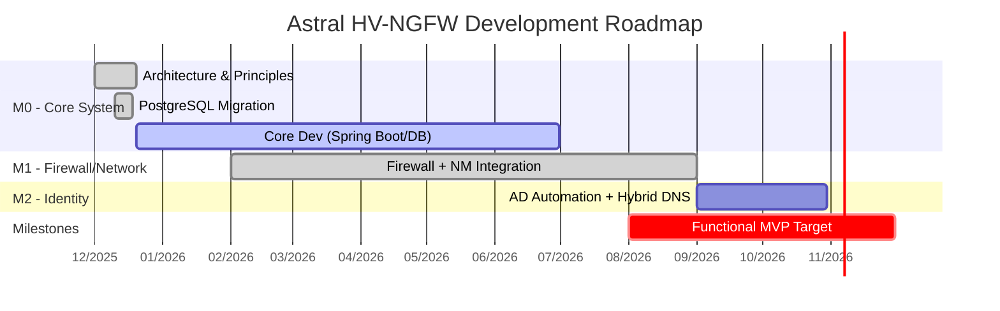
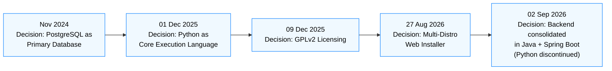
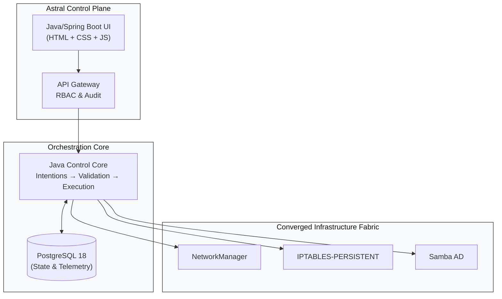
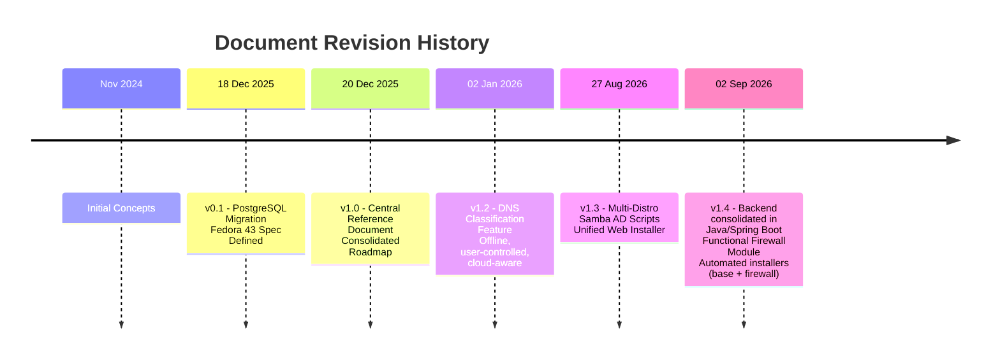

# Astral Platform & HCI – Reference and Updates Document
#
**Living Document – Version 1.4**
**Last updated:** 02 SEPTEMBER 2026

---

## 📋 ABOUT THIS DOCUMENT
*(unchanged)*

---

## 📅 UPDATE TIMELINE

### **18 DECEMBER 2025 – Version 0.1**
*(unchanged)*

### **20 DECEMBER 2025 – Version 1.0**
*(unchanged)*

### **02 JANUARY 2026 – Version 1.2**
**New feature**: **Context-Aware Sensitive DNS Classification and Selection**
- **Reason**: Enable offline, auditable, user-controlled DNS selection, aligned with Astral principles
- **Data source**: Public DNS list from `public-dns.info` (CSV-based, no live API calls)
- **Classification criteria**:
  - ✅ **Cloud provider** (via `as_org`: Google, Cloudflare, AWS, etc.)
  - ✅ **Country** (via `country_code`)
  - ✅ **Reliability ≥ 0.95 + DNSSEC = true**
- **Integration**:
  - Fully embedded in **Layer 4 (Network)** and **Layer 5 (Firewall)**
  - User selects DNS interactively during configuration
  - Selection propagates to **Pi-hole**, **dnsmasq** and **firewall policies**
- **Philosophical alignment**:
  - ✅ **Fallback over dependency**: all data stored locally
  - ✅ **Human authority**: the user chooses the DNS
  - ✅ **Auditability**: selected DNS recorded in PostgreSQL

### **27 AUGUST 2026 – Version 1.3**
**New feature**: **Multi-Distro Samba AD DC Scripts & Unified Web Installer**
- **Reason**: Expand identity-layer support to the main Linux families and simplify initial setup via a web UI.
- **Samba AD DC scripts**:
  - ✅ **Fedora/AlmaLinux**: `fedoradc-SSL.py` (with SSL/Step-CA) and `fedora42dc.py` (without SSL).
  - ✅ **Arch Linux**: `arch-DC-SSL.py` (with SSL) and `arch42dc-no-ssl.py` (without SSL).
  - ✅ **Debian 13**: `debian13-dc-ssl.py` (with SSL, AppArmor, modular BIND) and `debian13-dc-no-ssl.py` (without SSL).
  - 🔐 **Standardization**: all scripts now use `auth.env` for sensitive settings (`HOSTNAME_COMPLETO`, `REALM`, `SENHA_ADMIN`, `CERT_PWD`, etc.).
  - 🛡️ **Distro-specific security**:
    - Fedora/RHEL: SELinux configuration included.
    - Debian: custom AppArmor profiles for Samba and BIND.
    - Arch: path and package adjustments (`pacman`, `iptables-services`).
- **Unified Web Installer (`instalador.py` + `frontend/index.html`)**:
  - 🚀 **Execution**: runs via `sudo python3 instalador.py` directly from the Git repository root.
  - 🌐 **Remote access**: embedded Flask server, accessible from another machine's browser (`http://SERVER_IP:5000`).
  - 🔄 **10-step flow**:
    1. Execution with `sudo` in the Git directory.
    2. Automatic detection of the machine's IP.
    3. Access address displayed in the terminal.
    4. SSE (Server-Sent Events) handshake with the frontend.
    5. Repository synchronization (`apt-get update` / `dnf makecache` / `pacman -Sy`).
    6. Silent installation of Node.js and NPM.
    7. **PostgreSQL installation with real-time feedback** (shows the package being installed and a progress bar).
    8. Socket validation on port 5432 and service start.
    9. Transition to the credentials form (admin user and master password).
    10. Superuser and **`astral`** database creation via `sudo -i -u postgres psql`.
  - 🧠 **Automatic distro detection**:
    - Reads `/etc/os-release` to identify Debian/Ubuntu, RHEL/Fedora/Alma or Arch Linux.
    - Automatically adapts commands (`apt`, `dnf`, `pacman`) and package names.
  - 🗄️ **`astral` database creation**: the installer automatically creates the application's main database and grants full privileges to the created user.
  - 🎨 **React-style frontend**: clean interface with animated progress bar, real-time installation log and smooth transition to the final dashboard.

### **02 SEPTEMBER 2026 – Version 1.4 (Current)**
**Stack consolidation**: **Unified backend in Java + Spring Boot**
- **Reason**: Reduce the core technology surface, eliminate the duplication between the planned Python service and the Spring Boot layer, and simplify operation/deployment.
- **Backend**:
  - ✅ **Java + Spring Boot** is now the **only** backend technology of the project — covers UI, orchestration and infrastructure modules (e.g. Firewall).
  - ❌ The Python core (previously planned in Layer 2) was **discontinued**. All logic previously planned in Python (validation, reconciliation, execution) is now implemented in Java.
- **Frontend**:
  - ✅ **Pure JavaScript, HTML and CSS** — no build framework (no React/Vue at the moment).
  - 📋 **Node.js**: reserved for future use (e.g. build tooling, SSR of more complex components); **not yet adopted** in the project.
- **Automated installers**:
  - 🧩 **Base System Installer** (`Installer.java`): provisions packages and dependencies from scratch — Java/JDK, PostgreSQL, systemd units, project structure (`fabric/`, `src/`), `astral` database, administrator user and the main platform itself (`astral-platform`).
  - 🧩 **Firewall Module Installer** (`InstallerFirewall.java`): standalone, provisions specifically the `astral-firewall` service (Spring Boot + iptables), including Maven build, systemd unit, and initial port release.
  - Both installers are **idempotent** (can be run again safely) and run as autonomous Java processes via `sudo java <Installer>.java`, with no dependency on Python package managers.
- **Firewall module**: moves from "planned" to **functional** — see Layer 5 below.

---

## 🎯 FUNDAMENTAL PRINCIPLES (IMMUTABLE)
*(unchanged)*

---

## 🏗️ IMPLEMENTATION STATUS BY LAYER

```mermaid
flowchart TB
    subgraph L_APP [Application & Orchestration]
        direction TB
        L1["Layer 1: UI & Orchestration<br/>(Java + Spring Boot)<br/>🔄 In Dev (25%)"]
        L2["Layer 2: Service Core<br/>(Java + Spring Boot — Python discontinued)<br/>🔄 In Dev (15%)"]
        L3["Layer 3: PostgreSQL Database<br/>(Schema & Extensions)<br/>✅ Updated (20%)"]
    end

    subgraph L_NET [Network & Security]
        direction TB
        L4["Layer 4: Network (NetworkManager)<br/>✅ Enhanced with DNS classification"]
        L5["Layer 5: Firewall (iptables)<br/>✅ Functional — rules, NAT/Port Forwarding,<br/>Masquerade, Rate Limiting and Panic Mode"]
        L6["Layer 6: Identity (Samba AD)<br/>✅ POC Implemented"]
        L7["Layer 7: Hybrid DNS<br/>✅ POC Implemented + upstream selection"]
    end

    subgraph L_INFRA [Infrastructure & Operations]
        direction TB
        L8["Layer 8: Hypervisor (KVM)<br/>📋 Planned (0%)"]
        L9["Layer 9: Citrix CVAD<br/>📋 Defined (Config Only)"]
        L10["Layer 10: Package System<br/>and Automated Installers<br/>✅ Base + Firewall implemented"]
        L11["Layer 11: Observability<br/>📋 In Design (3%)"]
    end

    %% Styles
    classDef implemented fill:#d4edda,stroke:#155724,stroke-width:2px;
    classDef inprogress fill:#fff3cd,stroke:#856404,stroke-width:2px;
    classDef planned fill:#e2e3e5,stroke:#383d41,stroke-width:1px;

    class L3,L4,L5,L6,L7,L10 implemented;
    class L1,L2 inprogress;
    class L8,L9,L11 planned;
```



---

## 🔄 DYNAMIC ROADMAP



> *(The roadmap will be updated continuously as work progresses)*

---

## 🐛 ARCHITECTURAL DECISION LOG



---

## 📊 UPDATED TECHNICAL SPECIFICATIONS

### **Official Development Environment**
- **OS**: Fedora 43 Workstation / Server
- **Architecture**: x86_64
- **Minimum RAM**: 4 GB
- **Storage**: 25 GB minimum

### **Technology Stack**
```text
Backend: Java 21 + Spring Boot 3.2+ (only backend technology)
  - Covers: UI, orchestration, reactive API (WebFlux) and infrastructure modules
  - Persistence: Spring Data JPA / Hibernate
  - Connection Pooling: HikariCP

Frontend: pure HTML, CSS and JavaScript
  - No build framework at the moment (no React/Vue)
  - Node.js: reserved for future use, not yet adopted

Database: PostgreSQL 18+
  - Extensions: timescaledb, pg_stat_statements, pgcrypto

System Integration:
  - Network: NetworkManager (nmcli, via Java process)
  - Firewall: iptables (dedicated Java/Spring Boot module, real-time
    synchronization between database and applied rules)
  - DNS: Hybrid (Pi-hole + dnsmasq) with offline public DNS catalog
  - Identity: Samba 4.20+ (AD Domain Controller)

Automated Installers (Java, standalone):
  - Base System: packages, dependencies, PostgreSQL, systemd, main platform
  - Firewall Module: Maven build, systemd unit, initial rules via iptables

Offline Data Sources:
  - CSV from public-dns.info (nameservers.csv) → embedded at build time
  - Cloud IP ranges (AWS, GCP, Azure, OVH) → optional enrichment
```

---

## 🖼️ HIGH-LEVEL ARCHITECTURE



---

## ⚠️ KNOWN LIMITATIONS AND CONSTRAINTS

### **Current Restrictions**
- ❌ **No Docker support**: native installation only (Fedora/RHEL)
- ❌ **No Citrix VDI included**: only configuration compatibility if the user provides Citrix
- ⚠️ **Minimum 4 GB RAM** required for basic operation
- 🔧 **Nested virtualization required** for development environments

---

## 🤝 COLLABORATION MODEL

### **For Developers**
- Repository fork (when public)
- Consult this document for architectural context
- Adhere to the four fundamental principles

### **For Testers / Users**
- Report issues with clear usage scenarios
- Provide UX feedback

---

## 🏷️ DOCUMENT VERSION HISTORY



---

## 🚨 FINAL NOTICE

This is a **living development document**.

All specifications, architecture and decisions documented are **subject to change without prior notice**. This document reflects the current state of thought and development of the **Astral HV-NGFW** project, but **does not constitute a final commitment** to any specific implementation.