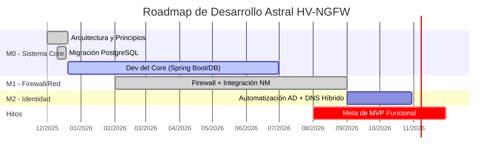
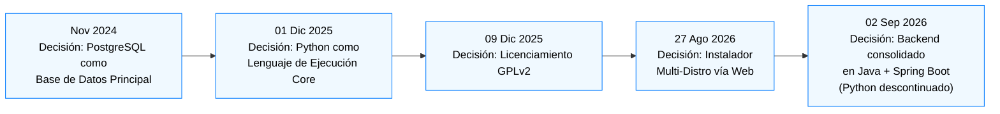
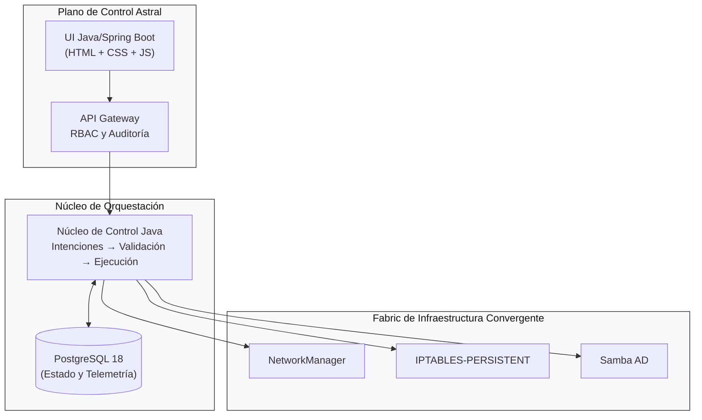
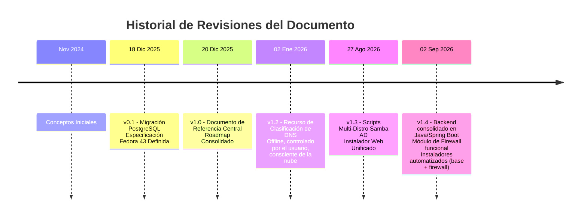

# Astral Platform & HCI – Documento de Referencia y Actualizaciones
#
**Documento Vivo – Versión 1.4**
**Última actualización:** 02 DE SEPTIEMBRE DE 2026

---

## 📋 SOBRE ESTE DOCUMENTO
*(sin cambios)*

---

## 📅 CRONOLOGÍA DE ACTUALIZACIONES

### **18 DE DICIEMBRE DE 2025 – Versión 0.1**
*(sin cambios)*

### **20 DE DICIEMBRE DE 2025 – Versión 1.0**
*(sin cambios)*

### **02 DE ENERO DE 2026 – Versión 1.2**
**Nuevo recurso**: **Clasificación y Selección de DNS Sensible al Contexto**
- **Motivo**: Habilitar selección de DNS offline, auditable y controlada por el usuario, alineada a los principios de Astral
- **Fuente de datos**: Lista pública de DNS de `public-dns.info` (basada en CSV, sin llamadas a API en vivo)
- **Criterios de clasificación**:
  - ✅ **Proveedor de nube** (vía `as_org`: Google, Cloudflare, AWS, etc.)
  - ✅ **País** (vía `country_code`)
  - ✅ **Confiabilidad ≥ 0,95 + DNSSEC = true**
- **Integración**:
  - Totalmente integrado en la **Capa 4 (Red)** y la **Capa 5 (Firewall)**
  - El usuario selecciona el DNS interactivamente durante la configuración
  - La selección se propaga a **Pi-hole**, **dnsmasq** y **políticas de firewall**
- **Alineación filosófica**:
  - ✅ **Fallback sobre dependencia**: todos los datos almacenados localmente
  - ✅ **Autoridad humana**: el usuario elige el DNS
  - ✅ **Auditabilidad**: DNS seleccionado registrado en PostgreSQL

### **27 DE AGOSTO DE 2026 – Versión 1.3**
**Nuevo recurso**: **Scripts Multi-Distro de Samba AD DC e Instalador Web Unificado**
- **Motivo**: Ampliar el soporte de la capa de identidad a las principales familias Linux y simplificar la configuración inicial mediante una UI web.
- **Scripts Samba AD DC**:
  - ✅ **Fedora/AlmaLinux**: `fedoradc-SSL.py` (con SSL/Step-CA) y `fedora42dc.py` (sin SSL).
  - ✅ **Arch Linux**: `arch-DC-SSL.py` (con SSL) y `arch42dc-no-ssl.py` (sin SSL).
  - ✅ **Debian 13**: `debian13-dc-ssl.py` (con SSL, AppArmor, BIND modular) y `debian13-dc-no-ssl.py` (sin SSL).
  - 🔐 **Estandarización**: todos los scripts usan ahora `auth.env` para configuraciones sensibles (`HOSTNAME_COMPLETO`, `REALM`, `SENHA_ADMIN`, `CERT_PWD`, etc.).
  - 🛡️ **Seguridad específica por distro**:
    - Fedora/RHEL: configuración de SELinux incluida.
    - Debian: perfiles personalizados de AppArmor para Samba y BIND.
    - Arch: ajustes de rutas y paquetes (`pacman`, `iptables-services`).
- **Instalador Web Unificado (`instalador.py` + `frontend/index.html`)**:
  - 🚀 **Ejecución**: se ejecuta con `sudo python3 instalador.py` directamente desde la raíz del repositorio Git.
  - 🌐 **Acceso remoto**: servidor Flask embebido, accesible desde el navegador de otra máquina (`http://IP_DEL_SERVIDOR:5000`).
  - 🔄 **Flujo de 10 etapas**:
    1. Ejecución con `sudo` en el directorio Git.
    2. Detección automática de la IP de la máquina.
    3. Dirección de acceso mostrada en la terminal.
    4. Handshake SSE (Server-Sent Events) con el frontend.
    5. Sincronización del repositorio (`apt-get update` / `dnf makecache` / `pacman -Sy`).
    6. Instalación silenciosa de Node.js y NPM.
    7. **Instalación de PostgreSQL con feedback en tiempo real** (muestra el paquete instalándose y una barra de progreso).
    8. Validación de socket en el puerto 5432 e inicio del servicio.
    9. Transición al formulario de credenciales (usuario admin y contraseña maestra).
    10. Creación del superusuario y de la base **`astral`** vía `sudo -i -u postgres psql`.
  - 🧠 **Detección automática de distro**:
    - Lee `/etc/os-release` para identificar Debian/Ubuntu, RHEL/Fedora/Alma o Arch Linux.
    - Adapta automáticamente los comandos (`apt`, `dnf`, `pacman`) y los nombres de paquetes.
  - 🗄️ **Creación de la base `astral`**: el instalador crea automáticamente la base principal de la aplicación y otorga privilegios totales al usuario creado.
  - 🎨 **Frontend estilo React**: interfaz limpia con barra de progreso animada, log de instalación en tiempo real y transición suave al dashboard final.

### **02 DE SEPTIEMBRE DE 2026 – Versión 1.4 (Actual)**
**Consolidación de stack**: **Backend unificado en Java + Spring Boot**
- **Motivo**: Reducir la superficie de tecnologías del core, eliminar la duplicidad entre el servicio Python planeado y la capa Spring Boot, y simplificar operación/despliegue.
- **Backend**:
  - ✅ **Java + Spring Boot** es ahora la **única** tecnología de backend del proyecto — cubre UI, orquestación y los módulos de infraestructura (p. ej. Firewall).
  - ❌ El núcleo en Python (antes previsto en la Capa 2) fue **descontinuado**. Toda la lógica anteriormente planeada en Python (validación, reconciliación, ejecución) pasa a implementarse en Java.
- **Frontend**:
  - ✅ **JavaScript, HTML y CSS puros** — sin framework de build (sin React/Vue por ahora).
  - 📋 **Node.js**: reservado para uso futuro (p. ej. build tooling, SSR de componentes más complejos); **aún no adoptado** en el proyecto.
- **Instaladores automatizados**:
  - 🧩 **Instalador del Sistema Base** (`Installer.java`): provisiona paquetes y dependencias desde cero — Java/JDK, PostgreSQL, unidades systemd, estructura del proyecto (`fabric/`, `src/`), base `astral`, usuario administrador y la propia plataforma principal (`astral-platform`).
  - 🧩 **Instalador del Módulo de Firewall** (`InstallerFirewall.java`): standalone, provisiona específicamente el servicio `astral-firewall` (Spring Boot + iptables), incluyendo build Maven, unit systemd y liberación inicial de puertos.
  - Ambos instaladores son **idempotentes** (pueden ejecutarse de nuevo con seguridad) y corren como procesos Java autónomos vía `sudo java <Instalador>.java`, sin dependencia de gestores de paquetes Python.
- **Módulo de Firewall**: pasa de "planeado" a **funcional** — ver Capa 5 abajo.

---

## 🎯 PRINCIPIOS FUNDAMENTALES (INMUTABLES)
*(sin cambios)*

---

## 🏗️ ESTADO DE IMPLEMENTACIÓN POR CAPA

```mermaid
flowchart TB
    subgraph L_APP [Aplicación y Orquestación]
        direction TB
        L1["Capa 1: UI y Orquestación<br/>(Java + Spring Boot)<br/>🔄 En Dev (25%)"]
        L2["Capa 2: Núcleo de Servicios<br/>(Java + Spring Boot — Python descontinuado)<br/>🔄 En Dev (15%)"]
        L3["Capa 3: Base de Datos PostgreSQL<br/>(Esquema y Extensiones)<br/>✅ Actualizado (20%)"]
    end

    subgraph L_NET [Red y Seguridad]
        direction TB
        L4["Capa 4: Red (NetworkManager)<br/>✅ Mejorada con clasificación de DNS"]
        L5["Capa 5: Firewall (iptables)<br/>✅ Funcional — reglas, NAT/Port Forwarding,<br/>Masquerade, Rate Limiting y Modo Pánico"]
        L6["Capa 6: Identidad (Samba AD)<br/>✅ POC Implementado"]
        L7["Capa 7: DNS Híbrido<br/>✅ POC Implementado + selección de upstream"]
    end

    subgraph L_INFRA [Infraestructura y Operaciones]
        direction TB
        L8["Capa 8: Hipervisor (KVM)<br/>📋 Planeado (0%)"]
        L9["Capa 9: Citrix CVAD<br/>📋 Definido (Solo Config)"]
        L10["Capa 10: Sistema de Paquetes<br/>e Instaladores Automatizados<br/>✅ Base + Firewall implementados"]
        L11["Capa 11: Observabilidad<br/>📋 En Diseño (3%)"]
    end

    %% Estilos
    classDef implemented fill:#d4edda,stroke:#155724,stroke-width:2px;
    classDef inprogress fill:#fff3cd,stroke:#856404,stroke-width:2px;
    classDef planned fill:#e2e3e5,stroke:#383d41,stroke-width:1px;

    class L3,L4,L5,L6,L7,L10 implemented;
    class L1,L2 inprogress;
    class L8,L9,L11 planned;
```



---

## 🔄 ROADMAP DINÁMICO



> *(El roadmap se actualizará continuamente conforme avance el trabajo)*

---

## 🐛 REGISTRO DE DECISIONES ARQUITECTÓNICAS



---

## 📊 ESPECIFICACIONES TÉCNICAS ACTUALIZADAS

### **Entorno de Desarrollo Oficial**
- **SO**: Fedora 43 Workstation / Server
- **Arquitectura**: x86_64
- **RAM mínima**: 4 GB
- **Almacenamiento**: 25 GB mínimo

### **Stack Tecnológico**
```text
Backend: Java 21 + Spring Boot 3.2+ (única tecnología de backend)
  - Cubre: UI, orquestación, API reactiva (WebFlux) y módulos de infraestructura
  - Persistencia: Spring Data JPA / Hibernate
  - Connection Pooling: HikariCP

Frontend: HTML, CSS y JavaScript puros
  - Sin framework de build por ahora (sin React/Vue)
  - Node.js: reservado para uso futuro, aún no adoptado

Base de Datos: PostgreSQL 18+
  - Extensiones: timescaledb, pg_stat_statements, pgcrypto

Integración con el Sistema:
  - Red: NetworkManager (nmcli, vía proceso Java)
  - Firewall: iptables (módulo Java/Spring Boot dedicado, sincronización
    en tiempo real entre base de datos y reglas aplicadas)
  - DNS: Híbrido (Pi-hole + dnsmasq) con catálogo público de DNS offline
  - Identidad: Samba 4.20+ (Controlador de Dominio AD)

Instaladores Automatizados (Java, standalone):
  - Sistema Base: paquetes, dependencias, PostgreSQL, systemd, plataforma principal
  - Módulo de Firewall: build Maven, unit systemd, reglas iniciales vía iptables

Fuentes de Datos (Offline):
  - CSV de public-dns.info (nameservers.csv) → incrustado en tiempo de build
  - Rangos de IP de nube (AWS, GCP, Azure, OVH) → enriquecimiento opcional
```

---

## 🖼️ ARQUITECTURA DE ALTO NIVEL



---

## ⚠️ LIMITACIONES Y RESTRICCIONES CONOCIDAS

### **Restricciones Actuales**
- ❌ **Sin soporte a Docker**: instalación nativa solo (Fedora/RHEL)
- ❌ **Sin Citrix VDI incluido**: solo compatibilidad de configuración si el usuario proporciona Citrix
- ⚠️ **Mínimo de 4 GB de RAM** requerido para operación básica
- 🔧 **Virtualización anidada necesaria** para entornos de desarrollo

---

## 🤝 MODELO DE COLABORACIÓN

### **Para Desarrolladores**
- Fork del repositorio (cuando sea público)
- Consultar este documento para contexto arquitectónico
- Adherirse a los cuatro principios fundamentales

### **Para Testers / Usuarios**
- Reportar problemas con escenarios de uso claros
- Proporcionar feedback de UX

---

## 🏷️ HISTORIAL DE VERSIONES DEL DOCUMENTO



---

## 🚨 AVISO FINAL

Este es un **documento vivo de desarrollo**.

Todas las especificaciones, arquitectura y decisiones documentadas están **sujetas a cambio sin aviso previo**. Este documento refleja el estado actual del pensamiento y desarrollo del proyecto **Astral HV-NGFW**, pero **no constituye un compromiso final** con ninguna implementación específica.