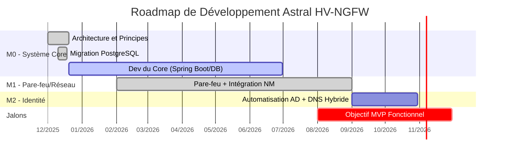
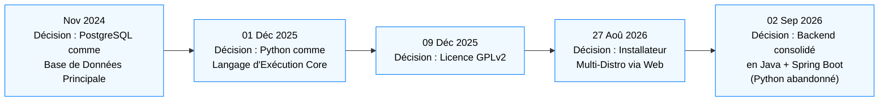
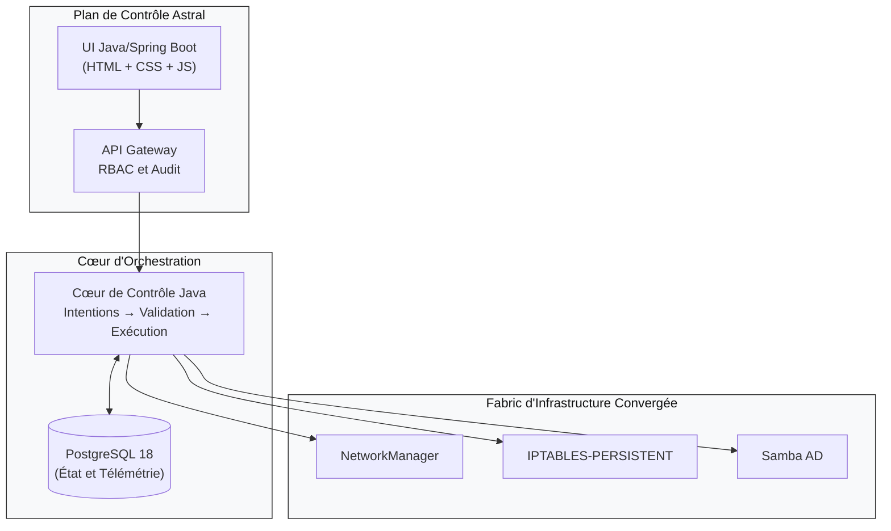
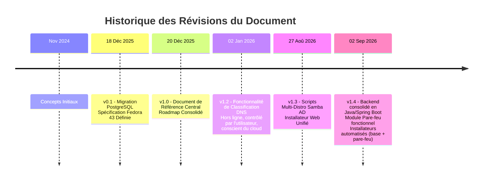

# Astral Platform & HCI – Document de Référence et Mises à Jour
#
**Document Vivant – Version 1.4**
**Dernière mise à jour :** 02 SEPTEMBRE 2026

---

## 📋 À PROPOS DE CE DOCUMENT
*(inchangé)*

---

## 📅 CHRONOLOGIE DES MISES À JOUR

### **18 DÉCEMBRE 2025 – Version 0.1**
*(inchangé)*

### **20 DÉCEMBRE 2025 – Version 1.0**
*(inchangé)*

### **02 JANVIER 2026 – Version 1.2**
**Nouvelle fonctionnalité** : **Classification et Sélection de DNS Sensible au Contexte**
- **Motif** : Permettre une sélection de DNS hors ligne, auditable et contrôlée par l'utilisateur, alignée sur les principes d'Astral
- **Source de données** : Liste publique de DNS de `public-dns.info` (basée sur CSV, sans appels d'API en direct)
- **Critères de classification** :
  - ✅ **Fournisseur de cloud** (via `as_org` : Google, Cloudflare, AWS, etc.)
  - ✅ **Pays** (via `country_code`)
  - ✅ **Fiabilité ≥ 0,95 + DNSSEC = true**
- **Intégration** :
  - Entièrement intégrée dans la **Couche 4 (Réseau)** et la **Couche 5 (Pare-feu)**
  - L'utilisateur sélectionne le DNS interactivement pendant la configuration
  - La sélection se propage à **Pi-hole**, **dnsmasq** et aux **politiques de pare-feu**
- **Alignement philosophique** :
  - ✅ **Fallback plutôt que dépendance** : toutes les données stockées localement
  - ✅ **Autorité humaine** : l'utilisateur choisit le DNS
  - ✅ **Auditabilité** : DNS sélectionné enregistré dans PostgreSQL

### **27 AOÛT 2026 – Version 1.3**
**Nouvelle fonctionnalité** : **Scripts Multi-Distro Samba AD DC et Installateur Web Unifié**
- **Motif** : Étendre le support de la couche d'identité aux principales familles Linux et simplifier la configuration initiale via une UI web.
- **Scripts Samba AD DC** :
  - ✅ **Fedora/AlmaLinux** : `fedoradc-SSL.py` (avec SSL/Step-CA) et `fedora42dc.py` (sans SSL).
  - ✅ **Arch Linux** : `arch-DC-SSL.py` (avec SSL) et `arch42dc-no-ssl.py` (sans SSL).
  - ✅ **Debian 13** : `debian13-dc-ssl.py` (avec SSL, AppArmor, BIND modulaire) et `debian13-dc-no-ssl.py` (sans SSL).
  - 🔐 **Standardisation** : tous les scripts utilisent désormais `auth.env` pour les paramètres sensibles (`HOSTNAME_COMPLETO`, `REALM`, `SENHA_ADMIN`, `CERT_PWD`, etc.).
  - 🛡️ **Sécurité spécifique à la distro** :
    - Fedora/RHEL : configuration SELinux incluse.
    - Debian : profils AppArmor personnalisés pour Samba et BIND.
    - Arch : ajustements de chemins et de paquets (`pacman`, `iptables-services`).
- **Installateur Web Unifié (`instalador.py` + `frontend/index.html`)** :
  - 🚀 **Exécution** : s'exécute via `sudo python3 instalador.py` directement depuis la racine du dépôt Git.
  - 🌐 **Accès distant** : serveur Flask intégré, accessible depuis le navigateur d'une autre machine (`http://IP_DU_SERVEUR:5000`).
  - 🔄 **Flux en 10 étapes** :
    1. Exécution avec `sudo` dans le répertoire Git.
    2. Détection automatique de l'IP de la machine.
    3. Adresse d'accès affichée dans le terminal.
    4. Poignée de main SSE (Server-Sent Events) avec le frontend.
    5. Synchronisation du dépôt (`apt-get update` / `dnf makecache` / `pacman -Sy`).
    6. Installation silencieuse de Node.js et NPM.
    7. **Installation de PostgreSQL avec retour en temps réel** (affiche le paquet en cours d'installation et une barre de progression).
    8. Validation du socket sur le port 5432 et démarrage du service.
    9. Transition vers le formulaire d'identifiants (utilisateur admin et mot de passe maître).
    10. Création du superutilisateur et de la base **`astral`** via `sudo -i -u postgres psql`.
  - 🧠 **Détection automatique de la distro** :
    - Lit `/etc/os-release` pour identifier Debian/Ubuntu, RHEL/Fedora/Alma ou Arch Linux.
    - Adapte automatiquement les commandes (`apt`, `dnf`, `pacman`) et les noms de paquets.
  - 🗄️ **Création de la base `astral`** : l'installateur crée automatiquement la base principale de l'application et accorde tous les privilèges à l'utilisateur créé.
  - 🎨 **Frontend style React** : interface épurée avec barre de progression animée, journal d'installation en temps réel et transition fluide vers le tableau de bord final.

### **02 SEPTEMBRE 2026 – Version 1.4 (Actuelle)**
**Consolidation de la stack** : **Backend unifié en Java + Spring Boot**
- **Motif** : Réduire la surface technologique du cœur, éliminer la duplication entre le service Python prévu et la couche Spring Boot, et simplifier l'exploitation/le déploiement.
- **Backend** :
  - ✅ **Java + Spring Boot** est désormais la **seule** technologie backend du projet — couvre l'UI, l'orchestration et les modules d'infrastructure (ex. Pare-feu).
  - ❌ Le cœur en Python (précédemment prévu dans la Couche 2) a été **abandonné**. Toute la logique précédemment prévue en Python (validation, réconciliation, exécution) est désormais implémentée en Java.
- **Frontend** :
  - ✅ **JavaScript, HTML et CSS purs** — sans framework de build (pas de React/Vue pour l'instant).
  - 📋 **Node.js** : réservé à un usage futur (ex. build tooling, SSR de composants plus complexes) ; **pas encore adopté** dans le projet.
- **Installateurs automatisés** :
  - 🧩 **Installateur du Système de Base** (`Installer.java`) : provisionne les paquets et dépendances de zéro — Java/JDK, PostgreSQL, unités systemd, structure du projet (`fabric/`, `src/`), base `astral`, utilisateur administrateur et la plateforme principale elle-même (`astral-platform`).
  - 🧩 **Installateur du Module Pare-feu** (`InstallerFirewall.java`) : autonome, provisionne spécifiquement le service `astral-firewall` (Spring Boot + iptables), y compris le build Maven, l'unité systemd et la libération initiale des ports.
  - Les deux installateurs sont **idempotents** (peuvent être relancés sans risque) et s'exécutent comme des processus Java autonomes via `sudo java <Installeur>.java`, sans dépendance aux gestionnaires de paquets Python.
- **Module Pare-feu** : passe de "prévu" à **fonctionnel** — voir Couche 5 ci-dessous.

---

## 🎯 PRINCIPES FONDAMENTAUX (IMMUABLES)
*(inchangé)*

---

## 🏗️ ÉTAT D'IMPLÉMENTATION PAR COUCHE

```mermaid
flowchart TB
    subgraph L_APP [Application et Orchestration]
        direction TB
        L1["Couche 1 : UI et Orchestration<br/>(Java + Spring Boot)<br/>🔄 En Dev (25%)"]
        L2["Couche 2 : Cœur de Services<br/>(Java + Spring Boot — Python abandonné)<br/>🔄 En Dev (15%)"]
        L3["Couche 3 : Base de Données PostgreSQL<br/>(Schéma et Extensions)<br/>✅ Mis à jour (20%)"]
    end

    subgraph L_NET [Réseau et Sécurité]
        direction TB
        L4["Couche 4 : Réseau (NetworkManager)<br/>✅ Améliorée avec classification DNS"]
        L5["Couche 5 : Pare-feu (iptables)<br/>✅ Fonctionnel — règles, NAT/Port Forwarding,<br/>Masquerade, Rate Limiting et Mode Panique"]
        L6["Couche 6 : Identité (Samba AD)<br/>✅ POC Implémenté"]
        L7["Couche 7 : DNS Hybride<br/>✅ POC Implémenté + sélection d'upstream"]
    end

    subgraph L_INFRA [Infrastructure et Opérations]
        direction TB
        L8["Couche 8 : Hyperviseur (KVM)<br/>📋 Prévu (0%)"]
        L9["Couche 9 : Citrix CVAD<br/>📋 Défini (Config uniquement)"]
        L10["Couche 10 : Système de Paquets<br/>et Installateurs Automatisés<br/>✅ Base + Pare-feu implémentés"]
        L11["Couche 11 : Observabilité<br/>📋 En Conception (3%)"]
    end

    %% Styles
    classDef implemented fill:#d4edda,stroke:#155724,stroke-width:2px;
    classDef inprogress fill:#fff3cd,stroke:#856404,stroke-width:2px;
    classDef planned fill:#e2e3e5,stroke:#383d41,stroke-width:1px;

    class L3,L4,L5,L6,L7,L10 implemented;
    class L1,L2 inprogress;
    class L8,L9,L11 planned;
```



---

## 🔄 ROADMAP DYNAMIQUE



> *(Le roadmap sera mis à jour en continu au fur et à mesure de l'avancement)*

---

## 🐛 JOURNAL DES DÉCISIONS ARCHITECTURALES



---

## 📊 SPÉCIFICATIONS TECHNIQUES MISES À JOUR

### **Environnement de Développement Officiel**
- **OS** : Fedora 43 Workstation / Server
- **Architecture** : x86_64
- **RAM minimale** : 4 GB
- **Stockage** : 25 GB minimum

### **Stack Technologique**
```text
Backend : Java 21 + Spring Boot 3.2+ (seule technologie backend)
  - Couvre : UI, orchestration, API réactive (WebFlux) et modules d'infrastructure
  - Persistance : Spring Data JPA / Hibernate
  - Connection Pooling : HikariCP

Frontend : HTML, CSS et JavaScript purs
  - Pas de framework de build pour l'instant (pas de React/Vue)
  - Node.js : réservé à un usage futur, pas encore adopté

Base de Données : PostgreSQL 18+
  - Extensions : timescaledb, pg_stat_statements, pgcrypto

Intégration avec le Système :
  - Réseau : NetworkManager (nmcli, via processus Java)
  - Pare-feu : iptables (module Java/Spring Boot dédié, synchronisation
    en temps réel entre base de données et règles appliquées)
  - DNS : Hybride (Pi-hole + dnsmasq) avec catalogue public de DNS hors ligne
  - Identité : Samba 4.20+ (Contrôleur de Domaine AD)

Installateurs Automatisés (Java, autonomes) :
  - Système de Base : paquets, dépendances, PostgreSQL, systemd, plateforme principale
  - Module Pare-feu : build Maven, unité systemd, règles initiales via iptables

Sources de Données (Hors ligne) :
  - CSV de public-dns.info (nameservers.csv) → intégré au moment du build
  - Plages d'IP cloud (AWS, GCP, Azure, OVH) → enrichissement optionnel
```

---

## 🖼️ ARCHITECTURE DE HAUT NIVEAU



---

## ⚠️ LIMITATIONS ET CONTRAINTES CONNUES

### **Restrictions Actuelles**
- ❌ **Pas de support Docker** : installation native uniquement (Fedora/RHEL)
- ❌ **Pas de Citrix VDI inclus** : uniquement compatibilité de configuration si l'utilisateur fournit Citrix
- ⚠️ **Minimum 4 Go de RAM** requis pour le fonctionnement de base
- 🔧 **Virtualisation imbriquée nécessaire** pour les environnements de développement

---

## 🤝 MODÈLE DE COLLABORATION

### **Pour les Développeurs**
- Fork du dépôt (lorsqu'il sera public)
- Consulter ce document pour le contexte architectural
- Respecter les quatre principes fondamentaux

### **Pour les Testeurs / Utilisateurs**
- Signaler les problèmes avec des scénarios d'usage clairs
- Fournir un retour d'expérience UX

---

## 🏷️ HISTORIQUE DES VERSIONS DU DOCUMENT



---

## 🚨 AVIS FINAL

Ceci est un **document vivant de développement**.

Toutes les spécifications, l'architecture et les décisions documentées sont **sujettes à modification sans préavis**. Ce document reflète l'état actuel de la réflexion et du développement du projet **Astral HV-NGFW**, mais **ne constitue pas un engagement final** envers une implémentation spécifique.